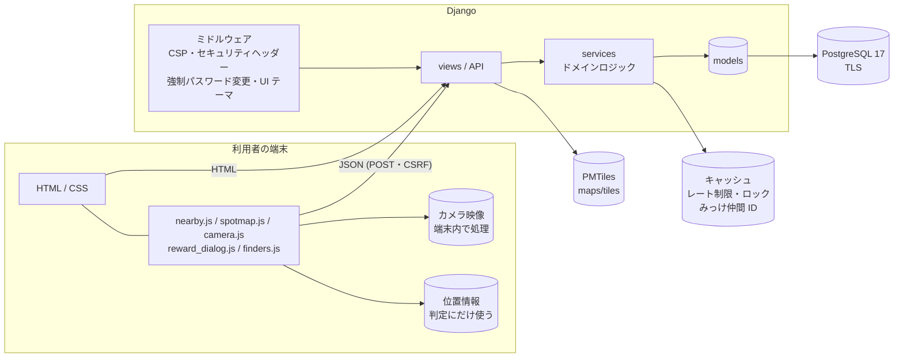
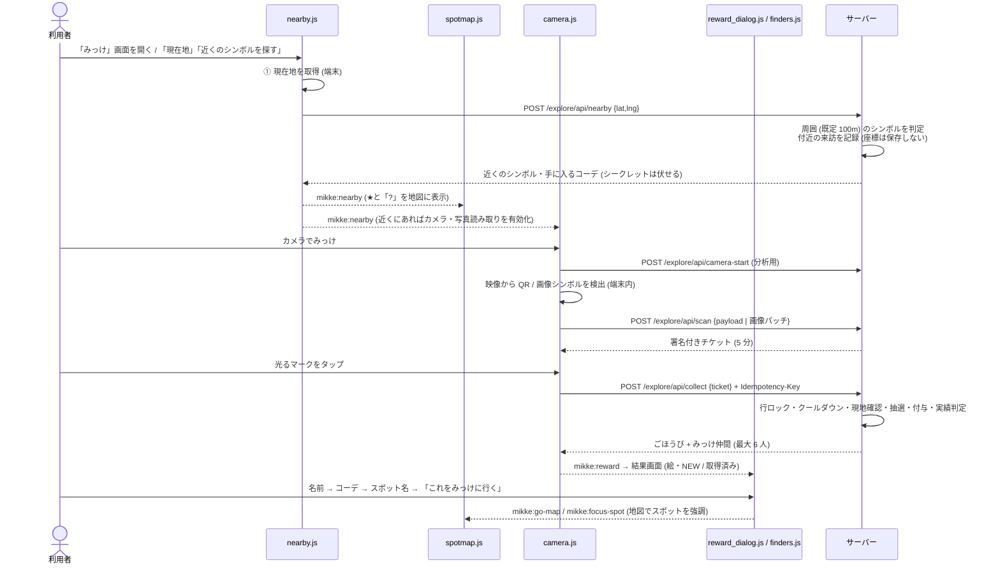
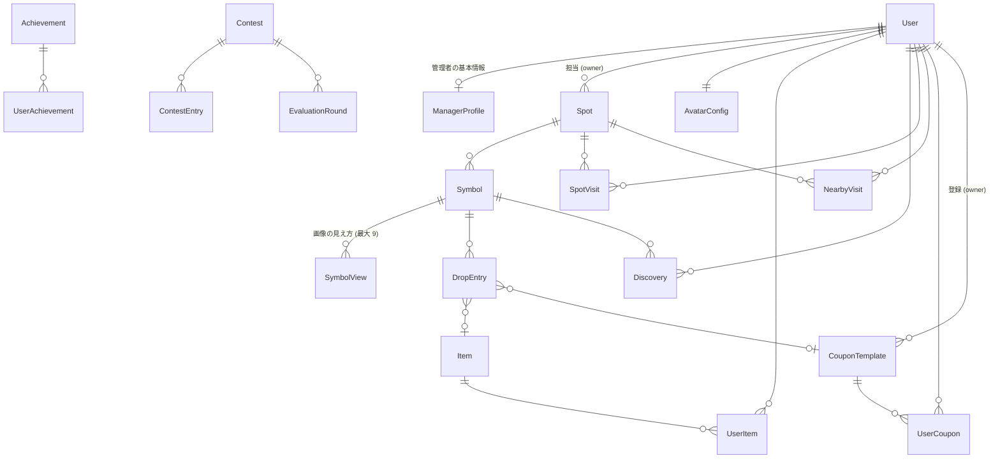

# みっけ 設計書

- 版: 2026-11-09(コミット `4be0e83` 時点の実装に基づく)
- 対象: 観光地の再訪を促す疑似 AR 着せ替え探索 Web アプリ「みっけ」
- 関連: [要件とトレーサビリティ](requirements.md) / [API 仕様](api.md) / [ADR](adr/) / [評価レポートと対応](reviews/)

---

## 1. 概要

### 1.1 目的
観光地に置いた「シンボル」(印刷した QR、または看板・像などの写真そのもの)をスマホのカメラでのぞくと、画面に光るマークが現れ、タップするとアバターの服(コーデ)や地元のお店のクーポンが手に入る。
スタンプラリーと違い、**季節・時間帯・再訪日数で手に入るものが変わる**ため、同じ場所に何度も来る理由が生まれる。

### 1.2 利用者と権限
| 権限 | 役割 | 登録 / 退会 | ログイン |
|---|---|---|---|
| 利用者 (`user`) | 探索・きせかえ・コンテスト・クーポン利用 | 自分で登録・退会 | 通常ログイン |
| 管理者 (`manager`) | 店舗・会社の担当者。**担当スポット**とシンボル・クーポンの設定 | サイト運営者が追加(仮パスワード → 初回変更) | 通常ログイン |
| サイト運営者 (`operator`) | 利用者管理・分析・全スポット・Django 管理画面 | `createadmin` / 管理画面 | **専用ログイン**(`MIKKE_OPS_URL`) |

### 1.3 用語
| 用語 | 意味 |
|---|---|
| スポット | 観光地の地点。公開期間(開始・有効期限)と担当の管理者を持つ |
| シンボル | スポットに置く目印。QR シンボル / 画像シンボル(最大 9 角度)。シークレット指定可 |
| ドロップ | シンボルから出るごほうびの抽選表(アイテム or クーポン、重み、季節・時間帯・訪問日数の条件) |
| みっけ | シンボルを読み取り、ごほうびを受け取ること(`Discovery`) |
| コーデ / アイテム | アバターのパーツ(顔・髪・トップス・ボトムス・くつ・こもの・エフェクト・背景) |
| みっけ仲間 | 直近 30 分に同じスポットでみっけした人(本人が公開を選んだ人だけ) |
| 付近の来訪 | 「近くのシンボルを探す」でスポットのシンボルが周囲にあったこと(分析用。座標は保存しない) |

---

## 2. システム構成

### 2.1 技術スタック
| 層 | 採用技術 | 備考 |
|---|---|---|
| サーバー | Python 3.13 / Django 6.1 | サーバーサイドレンダリング + JSON API |
| DB | PostgreSQL 17(TLS・SCRAM)/ 代替 SQLite | `DB_ENGINE` で切り替え |
| 暗号化 | AES-256-GCM のフィールド暗号化 + HMAC ブラインドインデックス | メール・住所・電話・引換コード |
| パスワード | Argon2 | 15 文字以上 |
| フロント | テンプレート + 素の JavaScript(ビルドなし) | CSP `script-src 'self'`、インラインスクリプト・スタイル禁止 |
| 読み取り | jsQR(QR)、jsfeat(画像の特徴点・ORB) | 映像はサーバーに送らない |
| 地図 | Leaflet + protomaps-leaflet、PMTiles をローカル配信 | 外部の地図 API を使わない |
| 画像 | サーバーで SVG を組み立て(アバター・クーポン・グラフ・QR) | 文字はすべてエスケープ |

### 2.2 構成図


### 2.3 ディレクトリ構成
```
config/        設定 (すべて環境変数から)・URL ルート
core/          横断機能: 暗号化 (crypto/fields)、監査ログ、レート制限、権限 (permissions)、
               ID 生成 (ids)、接続元 IP (net)、SVG 応答 (http)、季節・時間帯、UI テーマ、ホーム、
               シードコマンド (seed_mikke / seed_demo_users / seed_analytics)
accounts/      アカウント (3 権限)、管理者の基本情報、登録・ログイン・退会・パスワード変更
explore/       スポット・シンボル・ドロップ・訪問・みっけ記録、読み取り / 受け取り API、
               近くのシンボル判定、みっけ仲間 (finders)、スポット・シンボル・クーポンの設定画面 (manage_views)
wardrobe/      アイテム・所持品・アバター設定、SVG アバター描画 (avatar / scenes)
rewards/       クーポン (ひな形・発行・使用)、実績
contest/       コーデコンテスト (エントリー・評価・ランキング・BOT)
maps/          地図タイル (PMTiles) の Range 配信
ops/           サイト運営者の画面: 専用ログイン・分析 (analytics / charts)・利用者管理
templates/     画面テンプレート (アプリごとのフォルダ、includes/ は共通部品)
static/        css/ (themes/ に UI テーマ 4 案)、js/、img/、vendor/ (同梱ライブラリ)
scripts/       ローカル PostgreSQL 管理、地図タイル切り出し、仮想写真の生成
docs/          設計書 (このファイル)、要件、API、ADR、評価レポート
<app>/tests/   各アプリのテスト (test_*.py)
```
各アプリは **views(入出力)→ services(ドメインロジック)→ models(データと制約)** の層に分ける。権限の判定は `core/permissions.py` に集約する。

---

## 3. 権限・認証の設計

### 3.1 権限の判定
| 対象 | 判定 | 実装 |
|---|---|---|
| ログインが必要な画面 | 未ログインはログインへ | `login_required` / API は 401 JSON |
| スポット・シンボル・クーポンの設定 | 管理者(担当分のみ)・運営者(すべて)。利用者は 403 | `manager_required`、`managed_spots / managed_symbols / managed_coupons` |
| 他店の設定を URL で直接開いた | 404(存在を見せない) | 上記クエリセットで絞り込み |
| 運営画面 `/ops/` | 運営者のみ。未ログインは運営者ログインへ、それ以外は 404 | `operator_required` |
| Django 管理画面 | `is_staff`(= 運営者。role から自動で決まる) | `User.save()` |

### 3.2 ログイン
- 通常ログイン(利用者・管理者)と運営者ログインを分ける。運営者が通常ログインを使うと「メールアドレスまたはパスワードが違います」(運営者かどうかを明かさない)
- 失敗の上限: アカウント単位 5 回 / IP 単位 20 回で 15 分ロック。運営者ログインは上限 0.6 倍・ロック 2 倍・セッション 4 時間
- 接続元 IP は、信頼済みプロキシ(`MIKKE_TRUSTED_PROXIES`)経由のときだけ X-Forwarded-For を使う(`core/net.py`)
- 運営者が発行した仮パスワード(20 文字)のアカウントは、最初にパスワード変更を強制(`ForcePasswordChangeMiddleware`、API には 403 JSON)
- パスワードを忘れた場合は、問い合わせ先(`MIKKE_SUPPORT_CONTACT`)へ連絡 → 運営者が本人確認のうえ仮パスワードを発行

### 3.3 退会
利用者本人がパスワード + 確認チェックで退会。記録・アイテム・クーポン・コンテスト参加はすべて削除(監査ログには ID だけ残す)。管理者・運営者は自分では退会できない(運営者が停止)。

---

## 4. 機能設計

### 4.1 画面一覧
| 区分 | 画面 | URL |
|---|---|---|
| ログイン前 | トップ(UI テーマ別、遊び方 3 ステップ・仮想写真) | `/` |
| | 登録 / ログイン / パスワードを忘れた方 | `/accounts/signup/` `/accounts/login/` `/accounts/password/help/` |
| 利用者 | ホーム(ゲームホーム: 旅ランク・いまだけのコーデ・季節まであと○日) | `/` |
| | **みっけ**(①近くのシンボルをさがす → ②カメラでみっけ) | `/explore/` |
| | みっけ履歴 | `/explore/history/` |
| | きせかえ | `/wardrobe/` |
| | クーポン一覧・詳細(使う) / 実績 | `/rewards/coupons/` `/rewards/achievements/` |
| | コンテスト(一覧・詳細・エントリー・評価・ランキング) | `/contest/…` |
| | アカウント(ニックネーム・みっけ仲間の公開・パスワード・退会) | `/accounts/` |
| 管理者 | スポット・シンボル・QR 追加・画像シンボル登録・シンボル設定(ドロップ)・クーポン | `/explore/manage/…` `/explore/symbols/…` |
| 運営者 | 分析 / 利用者管理 / 管理者の追加・編集 | `/ops/` `/ops/users/` `/ops/managers/…` |

共通: ヘッダー(ロゴ・季節バッジ・「≡ メニュー」)、下のタブ(ホーム・きせかえ・みっけ・コンテスト・クーポン)。

### 4.2 みっけ(探索)の流れ


### 4.3 ごほうびの抽選(衣装全振り)
1. その日の訪問を記録(`SpotVisit`、日本時間の日付単位)し、訪問日数を数える
2. 条件(季節・時間帯・訪問日数)に合い、配布できるドロップから重みで 1 つ選ぶ
3. 選ばれなければ **ふだん用のコーデ**(体のタイプに合う・未所持を優先・レア度 2 まで)を渡す。「何もなし」は原則出ない
4. アイテムは所持品に加算(初めてなら NEW、持っていれば「取得済み」)、クーポンは引換コードを発行
5. `Discovery` に記録(同じ Idempotency-Key の再送には最初の結果を返す)し、実績を判定

### 4.4 みっけ仲間(こんな人が獲得しているよ)
- 直近 30 分に同じスポットでみっけした利用者(同じシンボルの人が先、最大 6 人)。**「みっけ仲間に表示する」が ON の人だけ**(初期値 OFF)
- 表示はニックネーム・今のコーデ・「さっき / ◯分前」。コーデを押すと「どのスポットでみっけしたか(季節)」、スポット名から地図へ案内
- 他人のページはランダムな ID(利用者 ID を含まない。見る人に結び付き 30 分で消える)でしか開けない。シークレット由来の取得場所は伏せる

### 4.5 管理者の設定
- スポット: 名前・位置(地図で選ぶ)・判定半径・公開期間(無期限可)・現地確認の要否。記録があるスポットは削除できず、非公開か期限切れにする
- シンボル: QR 追加 / 画像シンボル撮影登録(四角形の切り抜き・塗りつぶし除外・最大 9 角度・類似度 65%)、名前・ヒント・クールダウン・シークレット・個別の位置・ドロップ
- クーポン: タイトル・店舗名・特典・利用条件・関連スポット・有効日数・有効期限・配布の停止。クーポン ID `CP-xxxxxx`、配る 1 枚ごとに重ならない引換コード `MK-XXXX-XXXX`(1 回だけ使える)

### 4.6 運営者の分析
- 指標: 付近に来たユーザ・PV・カメラ起動・みっけ・コーデ獲得、**利用割合 = コーデ獲得ユーザ数 ÷ 付近に来たユーザ数 × 100**(人数は重複なし)
- 絞り込み: 期間・季節・時間帯・管理者・並び順。グラフ: スポット別(上位 15)・時間帯別・季節別の棒グラフと利用割合。全スポットは表
- グラフはサーバーで SVG を生成(CSP を緩めない)。色覚の違いでも区別できるパレットを検証済み、凡例・ツールチップ・表を併記

### 4.7 その他の機能
- きせかえ: 体のタイプ(だれでも自由)・肌 8 色・目 6 色・8 部位。運営者は全パーツを選べる。新規・何も着ていないアカウントは初期アイテムを着せる
- コンテスト: エントリー → 3 体 × 3 回の評価(各回 1 体まで高評価) → ランキング。表示回数の少ない順に優先、参加 10 人未満は BOT で補う(BOT への評価は数えない)
- UI テーマ 4 案(スタンダード・ゲームホーム・トラベルマガジン・和モダン)を運営者が管理画面で切り替え

---

## 5. データ設計

### 5.1 ER 図(主要)


### 5.2 テーブル定義(要点)
| モデル | 主な項目 | 制約・備考 |
|---|---|---|
| `accounts.User` | email(暗号化)・email_hash(一意)・nickname・role・is_active・is_staff(自動)・must_change_password・share_activity(初期 OFF) | role は 3 種、is_superuser は運営者のみ |
| `accounts.ManagerProfile` | manager_code(`MK-`、一意)・会社/店舗名・業種・担当者・郵便番号・**住所/電話(暗号化)**・Web・運営メモ | 郵便番号の形式 |
| `explore.Spot` | 名前・エリア・緯度経度・判定半径・現地確認・公開・starts_at / expires_at・owner | 期限 > 開始、緯度経度の範囲 |
| `explore.Symbol` | spot・kind(qr/image)・名前・ヒント・token(一意)・クールダウン・公開・シークレット・個別の緯度経度 | 緯度経度は両方 or なし |
| `explore.SymbolView` | 角度・参照 JPEG・特徴量・照合用パッチ/マスク(サーバーのみ) | シンボルごとに角度一意、特徴点 30 以上 |
| `explore.DropEntry` | item または coupon・重み・季節・時間帯・必要訪問日数 | ちょうど一方を持つ |
| `explore.SpotVisit` | 利用者・スポット・日付・季節 | 1 人 1 スポット 1 日 1 行 |
| `explore.NearbyVisit` | 利用者・スポット・日付・時間帯・季節・PV・カメラ起動回数 | **座標なし**、人・スポット・日・時間帯で 1 行 |
| `explore.Discovery` | 利用者・シンボル・ドロップ・ごほうびのスナップショット・Idempotency-Key・日時 | (利用者, キー) 一意 |
| `wardrobe.Item` / `UserItem` / `AvatarConfig` | 部位・体のタイプ・形・色・レア度 / 所持回数 / 装備と version(楽観ロック) | 色は `#RRGGBB` のみ |
| `rewards.CouponTemplate` | coupon_id(`CP-`、一意)・内容・関連スポット・有効日数・available_until・owner・配布する | 有効日数 ≥ 1 |
| `rewards.UserCoupon` | 引換コード(暗号化)・redeem_hash(一意)・発行/期限/使用日時 | 期限 > 発行、使用 ≥ 発行 |
| `rewards.Achievement` / `UserAchievement` | 条件の種類・しきい値・報酬 | 1 人 1 実績 1 回 |
| `contest.*` | 開催期間・回数・BOT の打ち切り人数 / エントリー(アバターのスナップショット)/ 評価ラウンド | 1 人 1 エントリー |
| `core.SiteSetting` | UI テーマ・カメラ起動の距離(10〜5000m) | 1 行のみ(60 秒キャッシュ) |
| `core.AuditLog` | 操作者・操作・対象・詳細・IP のハッシュ | 追記のみ(更新不可) |

### 5.3 データ保護
- 暗号化: メール・住所・電話・引換コード(AES-256-GCM、鍵 ID 付きでローテーション可、AAD で行に結び付け)
- 照合: ブラインドインデックス(HMAC-SHA256)でメール検索・引換コードの一意性
- 位置情報: 判定に使うだけで保存しない。分析は「どのスポットの付近に来たか」だけ
- カメラ映像: 端末内で処理し、送るのはシンボルの識別文字列 / 32×32 の照合パッチだけ

---

## 6. API 設計
JSON API はすべて POST + CSRF + `Content-Type: application/json`。ログインが必要で、未ログインは 401。詳細は [api.md](api.md)。

| API | 用途 | 主な制御 |
|---|---|---|
| `POST /explore/api/nearby` | 周囲のシンボル判定・地図表示 | 30 回/分、座標は保存しない、シークレットは伏せる |
| `POST /explore/api/camera-start` | カメラ起動の記録(分析用) | 30 回/分、直前 15 分の付近来訪に計上 |
| `GET /explore/api/image-symbols` | 画像シンボルの特徴量(照合パッチは含めない) | 5 分キャッシュ |
| `POST /explore/api/scan` | シンボルの判定 → 署名付きチケット | 60 回/分、画像は類似度 65% |
| `POST /explore/api/collect` | 受け取り | 20 回/分、Idempotency-Key、行ロック、クールダウン、現地確認 |
| `GET /explore/finders/<id>/` ほか | みっけ仲間のコーデ・絵 | 120 回/分(超過は 429)、ID は見る人専用・30 分 |
| SVG 画像(`/wardrobe/…svg` `/rewards/coupons/<id>.svg` など) | アバター・アイテム・クーポン・シンボル | `core/http.svg_response`(サンドボックス CSP) |

---

## 7. フロントエンド設計

| ファイル | 役割 | やりとり |
|---|---|---|
| `nearby.js` | ① 現在地取得 → ② シンボル検索(二重実行しない) | 出す: `mikke:nearby-start` `mikke:nearby` |
| `spotmap.js` | 地図・ピン(ズーム 14 以下はまとめて表示)・近くの★・コーデのポップアップ・スポット強調 | 受ける: `mikke:nearby` `mikke:find-shown` `mikke:focus-spot` |
| `camera.js` | カメラ / 写真読み取り・検出・受け取り・ボタンの有効化と理由表示 | 受ける: `mikke:nearby` `mikke:go-map` / 出す: `mikke:reward` |
| `reward_dialog.js` | 結果画面(絵・NEW / 取得済み・拡大図・実績) | 受ける: `mikke:reward` / 出す: `mikke:reward-shown` |
| `finders.js` | みっけ仲間・コーデ・「これをみっけに行く」 | 受ける: `mikke:reward-shown` / 出す: `mikke:go-map` `mikke:focus-spot` |
| `imagematch.js` / `symbol_register.js` | 画像の特徴点照合 / 撮影登録(切り抜き・塗りつぶし・9 角度) | |
| `wardrobe.js` / `spotpicker.js` / `expiryfield.js` / `confirm.js` | きせかえのプレビュー / 地図で位置選択 / 無期限の切り替え / 確認ダイアログ(`<dialog>`) | |

- 各ファイルは即時関数で閉じ、ファイル間はカスタムイベントでつなぐ(グローバル変数を増やさない)
- DOM は `textContent` / `createElement` で組み立てる(`innerHTML` にデータを入れない)
- 画面幅 375px 以上で崩れない。640px 未満では表をカード表示

---

## 8. セキュリティ設計(要点)
| 脅威 | 対策 |
|---|---|
| XSS | 自動エスケープ、CSP(`'self'` のみ・インライン禁止)、SVG は固定テンプレート + 検証済みの色、SVG 応答はサンドボックス |
| CSRF | Django の CSRF(API はヘッダー)、SameSite=Lax |
| 認証の総当たり | アカウント / IP ごとのロック、運営者ログインはより厳しく、Argon2・15 文字以上 |
| 権限昇格・IDOR | 権限は role から決定、所有者で絞り込んだクエリ、他店は 404 |
| 不正な受け取り | 署名付きチケット(利用者に結び付き 5 分)、Idempotency-Key、行ロック、クールダウン、現地確認、レート制限 |
| クーポンの不正利用 | 引換コードは一意・暗号化、条件付き UPDATE で 1 回だけ使用 |
| 情報漏えい | 暗号化保存、位置・映像を保存しない、運営画面の存在を隠す、エラー画面は日本語の独自ページ |
| 監査 | ログイン・設定変更・権限操作・退会などを追記専用の監査ログに記録(IP はハッシュ) |

---

## 9. 非機能・運用

### 9.1 主な設定(`.env`、見本は `.env.example`)
| 変数 | 内容 |
|---|---|
| `DJANGO_DEBUG` | **公開・デモ時は 0**(DEBUG 中は画面に警告帯) |
| `DJANGO_ADMIN_URL` / `MIKKE_OPS_URL` | Django 管理画面 / 運営者画面の場所(推測されにくい値に) |
| `MIKKE_FIELD_KEYS` / `MIKKE_BLIND_INDEX_KEY` | 暗号鍵(必須) |
| `DB_ENGINE` ほか `DB_*` | PostgreSQL / SQLite |
| `MIKKE_CACHE` | `locmem`(既定、1 プロセス)/ `db` / `redis://…` |
| `MIKKE_TRUSTED_PROXIES` | 信頼済みプロキシの IP / CIDR |
| `MIKKE_SUPPORT_CONTACT` | 「パスワードを忘れた方」の問い合わせ先 |
| `MIKKE_MAP_*` / `MIKKE_SHOW_SPOT_CARDS` | 地図の範囲・タイル / スポットカード一覧の表示 |

### 9.2 管理コマンド
| コマンド | 用途 |
|---|---|
| `seed_mikke` | 初期データ(アイテム・スポット・シンボル・クーポン・実績・コンテスト) |
| `seed_demo_users` / `seed_analytics` | 仮想利用者 / 分析用のスポット 100・利用者 1,000・1 年分の行動(`--recent` で直近 30 分のみっけ)。DEBUG 時のみ |
| `createadmin` | サイト運営者の作成 |
| `contest_reset_entry` | コンテストのエントリーを外す(確認用) |

### 9.3 品質
- テスト: 各アプリの `tests/`(291 件)。開発環境の PostgreSQL 17 で全件成功(`DB_ENGINE=sqlite` でも実行できる)
- 静的解析: ruff(セキュリティ規則 S を含む)、依存の脆弱性: pip-audit
- アクセシビリティ: タップ目標 44px 以上、文字 0.75rem 以上、`aria-describedby` / `aria-invalid`、レア度のテキスト代替、`prefers-reduced-motion`

---

## 10. 制約・今後の課題
- 地図データは大阪府 京橋付近のみ。実機スマホでのカメラ検出・GPS 精度は未計測(HTTPS 化が必要)
- 分析はその場で集計(数万行まで想定)。規模が大きくなったら日次の集計テーブルにする
- 画面は日本語のみ(多言語化する場合は `LocaleMiddleware` と `` を導入)
- メール送信の仕組みがないため、パスワードの再発行は運営者経由
- 個別の判断の経緯は [ADR](adr/)、評価レポートで対応しなかった項目と理由は [reviews/2026-11-09-response.md](reviews/2026-11-09-response.md)
