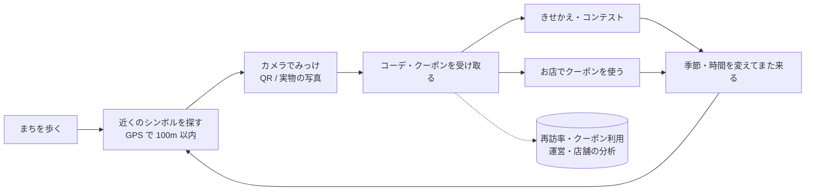

# みっけ(Mikke)概要

2026-11-10 時点。詳しくは [設計書](design.md)・[ADR](adr/) を参照。

## 1. ひとことで
**まちに隠れた「シンボル」をスマホのカメラでみっけして、アバターのコーデやお店のクーポンを集める、観光地の再訪を促す Web アプリ。**
季節・時間帯・訪問日数でもらえるコーデが変わるため、同じ場所に何度も来たくなる。集めたコーデはきせかえ・コンテストで楽しみ、お店はクーポンで来店につなげ、運営は再訪率で効果を確かめる。

## 2. 使う人
| 権限 | 立場 | 入口 | できること |
|---|---|---|---|
| 利用者 | 観光客・地元の人 | 通常ログイン(自分で登録・退会) | みっけ・きせかえ・コンテスト・クーポン・実績 |
| 管理者 | 店舗・会社の担当者 | 通常ログイン → **管理者コンソール** `/manage/` | 担当スポット・シンボル・クーポンの設定、クーポンの実績 |
| サイト運営者 | まち・サービスの運営者 | **専用ログイン**(URL は秘匿)→ **運営コンソール** | 分析・再訪率・利用者管理・全スポットの設定・サイネージ |
| だれでも | 通行人など | ログイン前の画面・サイネージ | トップ・ログイン画面のコーデとランキング、まちのサイネージ |

3 つの権限の画面とセッションは完全に分けている(管理者・運営者は利用者の機能を使えず、運営者のログインは運営側の URL でしか有効にならない)。

## 3. 主な機能

### 利用者
- **みっけ**: ①現在地を取得 → ②周囲のシンボルを地図で探す(地図にはスポットではなくシンボルだけを表示) → ③近く(既定 100m)にあればカメラを起動 → ④シンボル(印刷した QR / 看板や像など実物の写真)を写すと AR のマークが出て、タップで受け取る
- **ごほうび**: 必ずコーデがもらえる(「衣装全振り」)。季節・時間帯・訪問日数で中身が変わる。クーポンが出ることもある。シークレットシンボルもある
- **結果画面**: 手に入れたコーデの絵・レア度、「**こんな人も獲得しているよ**」(同じコーデを最近手に入れた人)、「こんな人が獲得しているよ」(同じ場所の直近 30 分)。名前を押すとその人のコーデ、スポット名を押すと地図で案内(目印のシンボル・ヒント・出る条件つき)
- **きせかえ**: ちびキャラのアバター(体のタイプ・肌・目・8 部位、142 種類のパーツ)
- **コーデコンテスト**: エントリー → 3 体から選ぶ評価 → ランキング
- **クーポン**: 1 枚ごとに重ならない引換コード、店頭で「使う」(1 回だけ)
- **実績・履歴**、UI テーマ 4 種(運営者が切り替え)

### 管理者(店舗)
- ホーム: 担当スポットの来訪・コーデ獲得(直近 30 日)、クーポンの使用枚数・**使用金額**
- スポット(地図で位置・公開期間)、QR シンボルの追加と印刷、画像シンボルの撮影登録(最大 9 角度)、ドロップ(手に入るコーデ・クーポン)の設定
- クーポンの登録(特典・**1 枚あたりの金額**・有効期限)と実績(配布・使用枚数・使用率・金額・月別グラフ)

### サイト運営者
- **利用状況の分析**: スポットごとの「付近に来た → カメラ起動 → コーデ獲得」、時間帯・季節別の棒グラフ
- **再訪率・アプリ利用率**: 再訪率 = 期間(既定 30 日)の中で、みっけ・クーポン利用が 2 日以上の人 ÷ 1 日以上の人。アプリ利用率 = その日に使った人 ÷ 登録者(日ごと)。月ごとの再訪率・来た日数の分布も
- **店舗ごとのクーポン利用**(使用枚数・使用金額)
- **まちのサイネージ**: ランキング 1 位のコーデ + 宣伝の文 + サイトの QR コードを作り、表示用の URL をサイネージ端末のブラウザで開く(ログイン不要・推測できないキー・自動更新)
- 利用者管理(管理者の追加・停止・仮パスワード)、全スポット・シンボル・クーポンの設定、アイテム一覧、サイト設定(UI テーマ・カメラ起動の距離)

### ログイン前の画面
- トップ(UI テーマ別)、ログイン画面に「**いま、まちで手に入るコーデ**」と**ランキング 1〜3 位**を右から左へ流す帯(一時停止ボタン付き)

## 4. 利用の流れ

## 5. しくみ
| 項目 | 内容 |
|---|---|
| サーバー | Python 3.13 / Django 6.1(画面はサーバーで組み立て + JSON API) |
| DB | PostgreSQL 17(TLS・SCRAM)。SQLite でも動く |
| 配信 | nginx 1.28(HTTPS・静的ファイル)→ waitress(アプリ本体は 127.0.0.1:8080 のみ) |
| フロント | テンプレート + 素の JavaScript(ビルドなし)。CSP で外部・インラインのスクリプトを禁止 |
| カメラ・照合 | jsQR(QR)、jsfeat(画像の特徴点)。映像は端末内で処理し、サーバーに送らない |
| 地図 | Leaflet + protomaps(地図データをローカル配信、外部の地図 API なし) |
| 絵 | アバター・クーポン・グラフ・QR をサーバーで SVG として作る |

アプリ構成: `core`(共通・セッション分離・ホーム)/ `accounts`(アカウント)/ `explore`(スポット・シンボル・みっけ・管理者の画面)/ `wardrobe`(アイテム・アバター)/ `rewards`(クーポン・実績)/ `contest`(コンテスト)/ `maps`(地図タイル)/ `ops`(運営コンソール・分析)/ `signage`(サイネージ)

## 6. セキュリティ・プライバシーの要点
- **暗号化**: メール・住所・電話番号・引換コードは AES-256-GCM で暗号化して保存(照合はハッシュ)。パスワードは Argon2
- **通信**: nginx で HTTPS(localhost 専用の自己署名証明書)。アプリ本体は外から直接つながらない
- **権限**: 利用者・管理者・運営者の画面とセッションを分離。他店のデータは開けない(404)。運営画面の URL は秘匿
- **不正防止**: ログインの失敗回数制限、受け取りの署名付きチケット・現地確認・移動速度チェック・レート制限、クーポンは 1 回だけ使える
- **位置・映像**: 位置は判定にだけ使い保存しない。カメラ映像は送らない
- **公開の画面**: ほかの人の名前を出すのは、本人が「みっけ仲間に表示する」を ON にしているときだけ(ログイン画面・サイネージのランキングも同じ)。アプリの利用記録は日付だけ
- **監査ログ**: ログイン・設定変更・権限操作・退会などを追記専用で記録(IP はハッシュ)

## 7. 起動と運用
- 起動: `start.bat`(PostgreSQL → マイグレーション → nginx + アプリ)、停止: `stop.bat`、状態: `python scripts\serve.py status`
- 開く: `https://localhost:8000`(証明書 `certs\localhost.crt` を「信頼されたルート証明機関」に登録すると警告が消える)
- 主な設定は `.env`(見本 `.env.example`)。デモデータ: `seed_mikke`(初期データ)・`seed_analytics`(スポット 100・管理者)・`seed_engagement`(利用者 10,000 人・1 年分。再訪率 約 20%・アプリ利用率 約 40%)

## 8. 品質
- 自動テスト 363 件(各アプリの `tests/`)、静的解析 ruff(セキュリティ規則を含む)、依存の脆弱性チェック pip-audit
- 設計判断は ADR 15 件([一覧](README.md))。アクセシビリティ: タップ目標 44px 以上、文字 0.75rem 以上、読み上げ用の説明、動きを減らす設定への対応、グラフは表でも確認可

## 9. いまの制約・今後
- 地図データは大阪府 京橋付近のみ。nginx は 127.0.0.1 だけで待ち受けるため、スマホなど LAN の端末から使うには公開方法の検討が必要(実機でのカメラ・GPS の精度は未計測)
- 分析はその場で集計(1 万人・1 年分で 1 秒以内)。規模が大きくなったら日ごとの集計テーブルにする
- 画面は日本語のみ。パスワードを忘れたときは運営者が仮パスワードを発行する(メール送信の仕組みはない)
