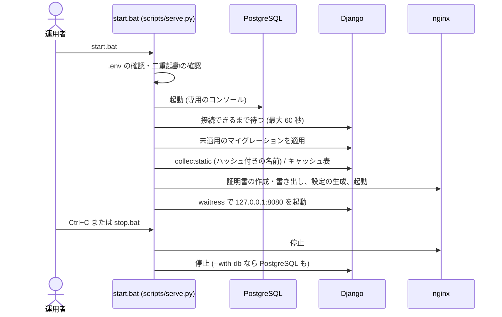
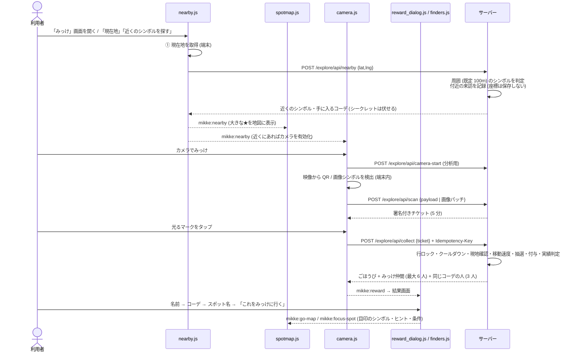
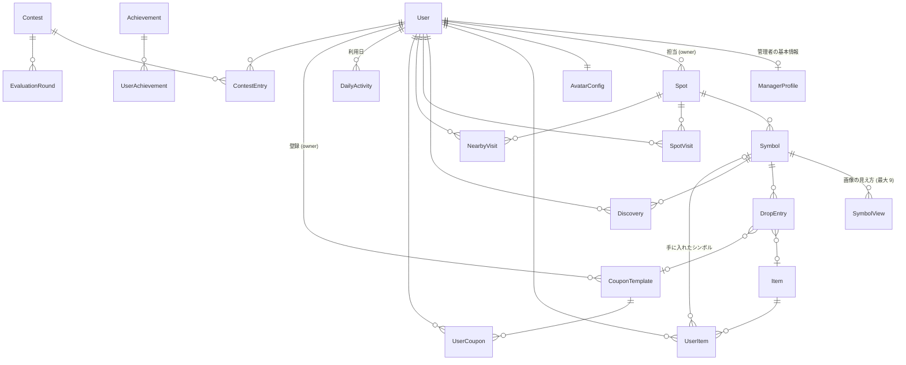

# みっけ(Mikke) 設計書

| 項目 | 内容 |
|---|---|
| 文書名 | みっけ 設計書 |
| 版 | 1.0(2026-11-10、コミット `fc50ce2` 時点の実装に基づく) |
| 対象 | 観光地の再訪を促す疑似 AR 着せ替え探索 Web アプリ「みっけ」 |
| 関連文書 | [README(仕様の要約)](../README.md) ・ [概要](../docs/overview.md) ・ [要件とトレーサビリティ](../docs/requirements.md) ・ [API 仕様](../docs/api.md) ・ [ADR](../docs/adr/) ・ [評価レポートへの対応](../docs/reviews/2026-11-09-response.md) |

## 目次
1. [概要](#1-概要)
2. [システム構成](#2-システム構成)
3. [機能一覧](#3-機能一覧)
4. [画面設計](#4-画面設計)
5. [処理設計](#5-処理設計)
6. [データ設計](#6-データ設計)
7. [API 設計](#7-api-設計)
8. [セキュリティ設計](#8-セキュリティ設計)
9. [非機能・運用設計](#9-非機能運用設計)
10. [試験](#10-試験)
11. [制約・今後の課題](#11-制約今後の課題)
- [付録 A. URL 一覧](#付録-a-url-一覧)

---

## 1. 概要

### 1.1 目的
観光地に置いた「シンボル」(印刷した QR、または看板・像などの実物そのもの)をスマホのカメラでのぞくと、画面に光るマークが現れ、タップするとアバターの服(コーデ)や地元のお店のクーポンが手に入る。
スタンプラリーと違い、**季節・時間帯・訪問日数で手に入るものが変わる**ため、同じ場所に何度も来る理由が生まれる。
お店はクーポンで来店につなげ、運営は再訪率・クーポンの使用枚数と金額で効果を確かめる。

### 1.2 対象範囲
- 対象地域: 大阪府 京橋付近(地図データを同梱)
- 利用環境: スマホ・PC のブラウザ(カメラ API のため HTTPS)。サーバーは Windows 上のローカル環境(nginx + waitress + PostgreSQL)
- 画面の言語: 日本語

### 1.3 利用者と権限
| 権限 | 役割 | 登録 / 退会 | ログイン | 画面 |
|---|---|---|---|---|
| 利用者 (`user`) | 探索・きせかえ・コンテスト・クーポン利用 | 自分で登録・自分で退会 | 通常ログイン | 利用者の画面 |
| 管理者 (`manager`) | 店舗・会社の担当者。**担当スポット**とシンボル・自分のクーポン | サイト運営者が追加(仮パスワード → 初回変更)、退会は運営者が停止 | 通常ログイン | **管理者コンソール** `/manage/` |
| サイト運営者 (`operator`) | 利用者管理・分析・全スポット・サイネージ・サイト設定 | `createadmin` | **専用ログイン**(URL は秘匿)、**専用のセッション Cookie** | **運営コンソール**・Django 管理画面 |
| だれでも | 通行人など | — | 不要 | トップ・ログイン画面・まちのサイネージ |

3 つの権限の画面とセッションは完全に分ける。管理者・運営者は利用者の画面を使えない([ADR 0013](../docs/adr/0013-console-separation-and-coupon-amounts.md))。

### 1.4 用語
| 用語 | 意味 |
|---|---|
| スポット | 観光地の地点。公開期間(開始・有効期限)と担当の管理者を持つ。地図には出さない |
| シンボル | スポットに置く目印。QR シンボル / 画像シンボル(最大 9 角度)。シークレット指定可 |
| ドロップ | シンボルから出るごほうびの抽選表(アイテム or クーポン、重み、季節・時間帯・訪問日数の条件) |
| みっけ | シンボルを読み取り、ごほうびを受け取ること(`Discovery`) |
| コーデ / アイテム | アバターのパーツ(顔・髪・トップス・ボトムス・くつ・こもの・エフェクト・背景) |
| みっけ仲間 | 直近にみっけした、ほかの利用者(本人が「みっけ仲間に表示する」を ON にした人だけ) |
| 付近の来訪 | 「近くのシンボルを探す」で、スポットのシンボルが周囲にあったこと(分析用。座標は保存しない) |
| 来た日 | みっけした日、またはクーポンを使った日(再訪率の単位) |
| 利用日 | 利用者がアプリを使った日(ログインだけも含む。アプリ利用率の単位) |
| コンソール | 管理者・運営者の画面(利用者の画面とは別の見た目・メニュー) |

---

## 2. システム構成

### 2.1 技術スタック
| 層 | 採用技術 | 備考 |
|---|---|---|
| Web サーバー | nginx 1.28 for Windows | TLS 1.2/1.3 の終端・http→https・静的ファイル・接続数と頻度の上限・X-Forwarded-For の上書き |
| アプリケーション | Python 3.13 / Django 6.1 + waitress 3.0 | サーバーサイドレンダリング + JSON API。127.0.0.1:8080 だけで待ち受け |
| DB | PostgreSQL 17 | TLS 1.3 必須・SCRAM 認証・データチェックサム。代替として SQLite |
| キャッシュ | Django DB キャッシュ(`MIKKE_CACHE=db`) | レート制限・ログインロック・みっけ仲間の ID。redis も可 |
| 暗号化 | AES-256-GCM のフィールド暗号化 + HMAC-SHA256 ブラインドインデックス | メール・住所・電話・引換コード |
| パスワード | Argon2 | 15 文字以上 |
| フロント | Django テンプレート + 素の JavaScript(ビルドなし) | CSP `script-src 'self'`、インラインスクリプト・スタイル禁止 |
| 読み取り | jsQR 1.4.0(QR)、jsfeat 0.0.8(画像の特徴点・ORB) | 映像は端末内で処理 |
| 地図 | Leaflet 1.9.4 + protomaps-leaflet 5.1.0、PMTiles(京橋付近 約 4.2MB) | 外部の地図 API を使わない |
| 画像 | サーバーで SVG を組み立て(アバター・クーポン・グラフ・QR) | 文字はすべてエスケープ |
| 証明書 | `cryptography` で作る localhost 専用の自己署名証明書 | 認証局としては使えない |

### 2.2 構成図
```mermaid
flowchart LR
  subgraph Device[利用者・管理者・運営者の端末 / サイネージ端末]
    UI[HTML / CSS] --- JS[nearby.js / spotmap.js / camera.js<br>reward_dialog.js / finders.js / marquee.js]
    JS --> CAM[(カメラ映像<br>端末内で処理)]
    JS --> GEO[(位置情報<br>判定にだけ使う)]
  end
  subgraph Host[サーバー (Windows・ローカル)]
    NX[nginx<br>https://localhost:8000<br>TLS・静的ファイル・上限] -- http 127.0.0.1:8080 --> APP
    subgraph APP[waitress + Django]
      MW[ミドルウェア<br>セッションの分離・権限の区域<br>CSP・利用日の記録] --> V[views / API]
      V --> S[services<br>ドメインロジック]
      S --> M[(models)]
    end
    M --> DB[(PostgreSQL 17<br>TLS・SCRAM)]
    S --> C[(キャッシュ<br>DB)]
    V --> T[(PMTiles<br>maps/tiles)]
    NX --> ST[(staticfiles<br>ハッシュ付きの名前)]
  end
  UI -- HTTPS --> NX
  JS -- JSON (POST・CSRF) --> NX
```

### 2.3 配置・ポート
| 要素 | 待ち受け | 備考 |
|---|---|---|
| nginx | `127.0.0.1:8000`(HTTPS) | 作業フォルダ `%LOCALAPPDATA%\mikke\proxy`(設定・ログ・証明書) |
| アプリ(waitress) | `127.0.0.1:8080`(HTTP) | nginx を通らないと外から届かない |
| PostgreSQL | `localhost:5432`(TLS 必須) | データ `%LOCALAPPDATA%\mikke\pgdata`。専用の見えないコンソールで動かし、起動した側を閉じても止まらない |
| 証明書 | `certs\localhost.crt`(公開部分だけ) | 秘密鍵は `%LOCALAPPDATA%\mikke\proxy\certs` |

### 2.4 アプリケーション構成
| Django アプリ | 役割 |
|---|---|
| `config` | 設定(すべて環境変数から)・URL ルート・テストランナー |
| `core` | 共通: 暗号化・監査ログ・レート制限・権限・セッションの分離・コンソールのメニュー・ID・季節/時間帯・UI テーマ・ホーム・ログイン画面のコーデ・利用日の記録・管理コマンド |
| `accounts` | アカウント(3 権限)、管理者の基本情報、登録・ログイン・退会・パスワード |
| `explore` | スポット・シンボル・ドロップ・訪問・みっけ記録、読み取り / 受け取り / 近くの判定 API、みっけ仲間、管理者の画面と設定画面 |
| `wardrobe` | アイテム・所持品(手に入れたシンボル)・アバター設定、SVG のアバター |
| `rewards` | クーポン(ひな形・発行・使用・実績の集計)、実績 |
| `contest` | コーデコンテスト(エントリー・評価・ランキング・BOT・公開用の上位) |
| `maps` | 地図タイル(PMTiles)の Range 配信 |
| `ops` | 運営コンソール: 専用ログイン・分析・再訪率・クーポン利用・利用者管理・サイネージの編集 |
| `signage` | まちのサイネージ(表示画面・内容の組み立て) |

各アプリは **views(入出力)→ services(ドメインロジック)→ models(データと制約)** の層に分ける。権限の判定は `core/permissions.py` と `core/middleware.py` に集約する。

### 2.5 起動・停止


---

## 3. 機能一覧

| ID | 区分 | 機能 | 概要 | 権限 | 主な画面 / API |
|---|---|---|---|---|---|
| F-01 | アカウント | 登録 | メール・ニックネーム・パスワード(15 文字以上)・みっけ仲間への表示の選択。登録すると初期アイテムを着る | だれでも | S-03 |
| F-02 | アカウント | ログイン / ログアウト | 通常ログイン(利用者・管理者)。失敗が続くとロック。ログイン後は権限ごとのホームへ | 利用者・管理者 | S-04 |
| F-03 | アカウント | 運営者ログイン | 専用の URL・専用の Cookie・より厳しいロック・4 時間 | 運営者 | S-40 |
| F-04 | アカウント | アカウント設定・退会 | ニックネーム・みっけ仲間への表示・パスワード変更・退会(記録はすべて削除) | 利用者 | S-18〜S-20 |
| F-05 | アカウント | 仮パスワードの強制変更 | 運営者が発行した仮パスワードでログインしたら、まず変更 | 全員 | S-19 / S-48 |
| F-10 | みっけ | 近くのシンボル判定 | 現在地の周囲(既定 100m)のシンボルを判定。なければいちばん近いスポットと距離 | 利用者 | S-11 / `api/nearby` |
| F-11 | みっけ | シンボルの地図 | シンボルだけを ★ / ✓ / ? で表示、まとめ表示、手に入るコーデの絵と条件 | 利用者 | S-11 |
| F-12 | みっけ | カメラで読み取り | QR・画像シンボルを端末内で検出し、追従する光るマーク(疑似 AR) | 利用者 | S-11 / `api/scan` |
| F-13 | みっけ | 受け取り | 署名付きチケット・現地確認・クールダウン・二重送信防止。必ずコーデ(衣装全振り) | 利用者 | S-12 / `api/collect` |
| F-14 | みっけ | 再訪の仕掛け | ドロップの季節・時間帯・訪問日数の条件、シンボルごとのクールダウン | 利用者 | — |
| F-15 | みっけ | 結果画面 | 絵・NEW / 取得済み・レア度・拡大図・実績のごほうび | 利用者 | S-12 |
| F-16 | みっけ | こんな人も獲得しているよ | 同じコーデを直近 7 日に手に入れた人を 3 人(レア度の横) | 利用者 | S-12 |
| F-17 | みっけ | こんな人が獲得しているよ | 直近 30 分に同じ場所でみっけした人を最大 6 人 | 利用者 | S-12 |
| F-18 | みっけ | みっけ仲間のコーデ | コーデと、どこで手に入れたか(スポット・季節) | 利用者 | S-13 / `finders/<id>/` |
| F-19 | みっけ | これをみっけに行く | 地図で目印のシンボルに案内(名前・ヒント・出る条件) | 利用者 | S-11 |
| F-20 | みっけ | みっけ履歴 | これまでのみっけの記録 | 利用者 | S-14 |
| F-21 | きせかえ | 着せ替え | 体のタイプ・肌・目・8 部位。持っているパーツだけ、プレビュー、楽観ロック | 利用者 | S-15 |
| F-22 | コンテスト | エントリー・評価・ランキング | 3 体 × 3 回の評価、表示回数の少ない順、BOT の補充 | 利用者 | S-16 |
| F-23 | クーポン | クーポンの利用 | 一覧・詳細(引換コード)・「使う」(1 回だけ) | 利用者 | S-17 |
| F-24 | 実績 | やりこみ実績 | 累計みっけ数・訪問スポット数・アイテム種類数・訪問日数・季節数 | 利用者 | S-17 |
| F-25 | 画面 | UI テーマ | 4 案を運営者が切り替え(利用者の画面だけ) | 運営者 | S-01 / S-10 |
| F-30 | 管理者 | 管理者ホーム | 担当スポットの来訪・カメラ・コーデ獲得、クーポンの使用枚数・金額(直近 30 日) | 管理者 | S-30 |
| F-31 | 管理者 | スポット管理 | 追加・編集・削除(地図で位置、公開期間・無期限、現地確認)。記録があれば削除不可 | 管理者・運営者 | S-31〜S-33 |
| F-32 | 管理者 | シンボル管理 | QR の追加・印刷・作り直し、画像シンボルの撮影登録(切り抜き・塗りつぶし・最大 9 角度)、ドロップ | 管理者・運営者 | S-34〜S-37 |
| F-33 | 管理者 | クーポン管理 | 登録・編集(1 枚あたりの金額・有効期限・配布停止)。クーポン ID `CP-` | 管理者・運営者 | S-38 |
| F-34 | 管理者 | クーポンの実績 | クーポンごとの配布・使用枚数・使用率・使用金額、月別グラフ | 管理者・運営者 | S-39 |
| F-35 | 管理者 | 店舗・会社の情報 | 管理者 ID・会社/店舗名・住所(暗号化)などの確認 | 管理者 | S-29 |
| F-40 | 運営者 | 利用状況の分析 | 付近 → カメラ → コーデ獲得、利用割合、時間帯・季節別、絞り込み | 運営者 | S-41 |
| F-41 | 運営者 | 再訪率・アプリ利用率 | 再訪率(30 日・1 年・月別・日数の分布)、日ごとのアプリ利用率 | 運営者 | S-42 |
| F-42 | 運営者 | 店舗ごとのクーポン利用 | 店舗ごとの枚数・使用率・金額と棒グラフ、店舗の詳細 | 運営者 | S-43 |
| F-43 | 運営者 | まちのサイネージ | 1 位のコーデ + 見出し + 宣伝の文 + QR。プレビュー・表示用 URL・作り直し | 運営者 | S-44 / S-45 / S-50 |
| F-44 | 運営者 | 利用者管理 | 一覧・検索・停止 / 再開・仮パスワードの発行。追加できるのは管理者だけ | 運営者 | S-46 / S-47 |
| F-45 | 運営者 | アイテム一覧・サイト設定 | 全パーツの一覧、UI テーマ・カメラを起動できる距離 | 運営者 | S-49 / Django 管理画面 |
| F-50 | 公開 | ログイン画面のコーデ・ランキング | 季節限定のコーデ 3 体 + ランキング 1〜3 位を流す帯(一時停止付き) | だれでも | S-04 |
| F-51 | 公開 | サイネージの表示 | 表示キーの URL でログイン不要、自動更新 | だれでも | S-50 |
| F-60 | 運用 | 起動・停止 | start.bat / stop.bat / serve.py status | 運用者 | — |
| F-61 | 運用 | デモデータ | seed_mikke / seed_analytics / seed_engagement / link_item_symbols | 開発者 | — |

---

## 4. 画面設計

### 4.1 画面一覧
| ID | 画面 | URL | 権限 | 主な表示・操作 |
|---|---|---|---|---|
| S-01 | トップ | `/`(未ログイン) | だれでも | UI テーマ別の見た目、遊び方、写真風 CG、はじめる / ログイン |
| S-03 | 登録 | `/accounts/signup/` | だれでも | メール・ニックネーム・パスワード・みっけ仲間への表示 |
| S-04 | ログイン | `/accounts/login/` | だれでも | 季節限定のコーデとランキングの流れる帯、ログインフォーム |
| S-05 | パスワードを忘れた方 | `/accounts/password/help/` | だれでも | 問い合わせ先 |
| S-10 | ホーム | `/` | 利用者 | 旅ランク・いまだけのコーデ・季節まで何日・イベント・みっけに行く |
| S-11 | みっけ | `/explore/` | 利用者 | ① 近くのシンボルをさがす(地図・現在地・近くのシンボル一覧)② カメラでみっけ(映像・マーク・受け取る) |
| S-12 | 結果(ダイアログ) | S-11 の中 | 利用者 | 絵・NEW / 取得済み・レア度・こんな人も獲得しているよ・こんな人が獲得しているよ・着せかえる |
| S-13 | みっけ仲間のコーデ(ダイアログ) | S-11 の中 | 利用者 | コーデ・アイテム・どこで手に入れたか・これをみっけに行く |
| S-14 | みっけ履歴 | `/explore/history/` | 利用者 | 日時・スポット・ごほうび |
| S-15 | きせかえ | `/wardrobe/` | 利用者 | プレビュー・体のタイプ・肌・目・部位ごとのパーツ・保存 |
| S-16 | コンテスト | `/contest/` ほか | 利用者 | 一覧・詳細・エントリー・評価・ランキング |
| S-17 | クーポン・実績 | `/rewards/coupons/` `/rewards/achievements/` | 利用者 | 一覧・詳細(引換コード・使う)・実績 |
| S-18 | アカウント | `/accounts/` | 利用者 | ニックネーム・みっけ仲間への表示 |
| S-19 | パスワード変更 | `/accounts/password/` | 利用者・管理者 | 現在 / 新しいパスワード(管理者はコンソールの見た目) |
| S-20 | 退会 | `/accounts/withdraw/` | 利用者 | パスワード・確認チェック |
| S-29 | 店舗・会社の情報 | `/manage/account/` | 管理者 | 管理者 ID・会社 / 店舗・住所・電話 |
| S-30 | 管理者ホーム | `/manage/` | 管理者 | 主な数(直近 30 日)・スポット上位・クーポン上位 |
| S-31 | スポット一覧 | `/manage/spots/` | 管理者・運営者 | 状態・公開期間・シンボル数・編集 / 削除 |
| S-32 | スポット編集 | `/manage/spots/new/` `…/<id>/edit/` | 管理者・運営者 | 地図で位置・半径・公開期間・現地確認・担当(運営者) |
| S-33 | スポット削除 | `/manage/spots/<id>/delete/` | 管理者・運営者 | 記録があれば非公開 / 期限切れを案内 |
| S-34 | シンボル一覧(印刷) | `/manage/symbols/` | 管理者・運営者 | QR の印刷・画像シンボルの角度 |
| S-35 | QR シンボル追加 / シンボル設定 | `/manage/symbols/new/` `…/<id>/` | 管理者・運営者 | 名前・ヒント・クールダウン・シークレット・位置・ドロップ・QR の作り直し |
| S-36 | 画像シンボル登録 | `/manage/symbols/register/` | 管理者・運営者 | 撮影・切り抜き・塗りつぶし・最大 9 角度 |
| S-37 | 撮影角度の管理 | `/manage/symbols/<id>/views/` | 管理者・運営者 | 角度の追加・撮り直し・削除 |
| S-38 | クーポン一覧 / 編集 | `/manage/coupons/` `…/new/` `…/<id>/` | 管理者・運営者 | 内容・1 枚あたりの金額・有効期限・配布 |
| S-39 | クーポンの実績 | `/manage/coupons/stats/` | 管理者・運営者 | 期間・合計・クーポンごとの表・月別グラフ |
| S-40 | 運営者ログイン | `/<運営 URL>/login/` | 運営者 | 専用のログイン |
| S-41 | 利用状況(分析) | `/<運営 URL>/` | 運営者 | 絞り込み・主な数・スポット別 / 時間帯別 / 季節別のグラフと表 |
| S-42 | 再訪率・アプリ利用率 | `…/engagement/` | 運営者 | 期間・主な数・日ごとの利用率・月ごとの再訪率・来た日数の分布 |
| S-43 | 店舗ごとのクーポン利用 | `…/coupons/` | 運営者 | 期間・合計・店舗ごとのグラフと表 → S-39(店舗で絞り込み) |
| S-44 | サイネージ一覧 | `…/signage/` | 運営者 | 名前・見出し・状態・編集 |
| S-45 | サイネージ編集 | `…/signage/new/` `…/<id>/` | 運営者 | 表示用 URL・作り直し・入力フォーム・プレビュー・削除 |
| S-46 | 利用者管理 | `…/users/` | 運営者 | 権限で絞り込み・検索・停止 / 再開・仮パスワード |
| S-47 | 管理者の追加 / 編集 | `…/managers/new/` `…/<id>/` | 運営者 | アカウント・基本情報・担当スポット・仮パスワードの発行 |
| S-48 | 運営者のパスワード変更 | `…/password/` | 運営者 | 運営側で変更 |
| S-49 | アイテム一覧 | `…/items/` | 運営者 | 体のタイプ別・部位別の全パーツ |
| S-50 | まちのサイネージ | `/signage/<表示キー>/` | だれでも | 16:9。1 位のアバター・名前・コンテスト・見出し・宣伝の文・QR |

運営者は S-31〜S-39 と同じ画面を運営 URL の下(`/<運営 URL>/manage/…`)で、すべてのスポット・クーポンについて使う。

### 4.2 画面遷移
```mermaid
flowchart TB
  subgraph Public[だれでも]
    S01[S-01 トップ] --> S03[S-03 登録]
    S01 --> S04[S-04 ログイン]
    S04 --> S05[S-05 パスワードを忘れた方]
    S50[S-50 サイネージ]
  end
  subgraph User[利用者の画面 (下のタブ)]
    S10[S-10 ホーム] --> S11[S-11 みっけ]
    S11 --> S12[S-12 結果] --> S13[S-13 みっけ仲間のコーデ]
    S13 -- これをみっけに行く --> S11
    S12 --> S15[S-15 きせかえ]
    S10 --> S15 & S16[S-16 コンテスト] & S17[S-17 クーポン・実績] & S14[S-14 履歴] & S18[S-18 アカウント]
    S18 --> S19[S-19 パスワード] & S20[S-20 退会]
  end
  subgraph Manager[管理者コンソール (左メニュー)]
    S30[S-30 ホーム] --> S31[S-31 スポット] --> S32[S-32 スポット編集]
    S30 --> S34[S-34 シンボル一覧] --> S35[S-35 シンボル設定]
    S34 --> S36[S-36 画像シンボル登録]
    S30 --> S38[S-38 クーポン] --> S39[S-39 クーポンの実績]
    S30 --> S29[S-29 店舗情報]
  end
  subgraph Ops[運営コンソール (左メニュー)]
    S40[S-40 運営者ログイン] --> S41[S-41 利用状況]
    S41 --> S42[S-42 再訪率] & S43[S-43 クーポン利用] & S44[S-44 サイネージ] & S46[S-46 利用者管理] & S49[S-49 アイテム一覧]
    S43 --> S39o[S-39 店舗のクーポン実績]
    S44 --> S45[S-45 サイネージ編集] -. 表示用 URL .-> S50
    S46 --> S47[S-47 管理者]
  end
  S04 -- 利用者 --> S10
  S04 -- 管理者 --> S30
```

### 4.3 共通レイアウト
| 区分 | ヘッダー | メニュー | 見た目 |
|---|---|---|---|
| 利用者の画面 | ロゴ・季節と時間帯のバッジ・「≡ メニュー」(履歴・実績・アカウント・ログアウト) | 下のタブ(ホーム・きせかえ・みっけ・コンテスト・クーポン、中央寄せ) | UI テーマ 4 案(スタンダード / ゲームホーム / トラベルマガジン / 和モダン) |
| 管理者コンソール | 青緑のヘッダー、「管理者コンソール」、店舗名と管理者 ID | 左メニュー(狭い画面では横 1 行): ホーム / スポット・シンボル / クーポン / アカウント | 固定 |
| 運営コンソール | 藍色のヘッダー、「運営コンソール」、ニックネーム | 左メニュー: 分析 / まちの宣伝 / 利用者 / 設定 / アカウント | 固定 |
| サイネージ | なし(全画面 16:9) | なし | 固定(画面の幅に合わせて拡大縮小) |

- 画面幅 375px 以上で崩れない。640px 未満では表をカード表示
- タップ目標 44px 以上、文字 0.75rem 以上、ダークモード対応、`prefers-reduced-motion` で動きを止める
- 動く表示(ログイン画面の帯)は一時停止ボタンを付ける

### 4.4 主要画面の詳細

**S-11 みっけ**
| 要素 | 内容 |
|---|---|
| ステップ表示 | ① 近くのシンボルをさがす / ② カメラでみっけ |
| 状態表示 | 位置の許可・検索中・「ここにはなさそう・・・」と距離 |
| 地図 | シンボルの印(★ / ✓ / ?)、まとめ表示(ズーム 15 以下)、現在地と判定の円、ズーム・現在地ボタン |
| 印のポップアップ | 名前(シークレットは ？？？)・スポット・ヒント・みっけ済みと次の日時 |
| 近くのシンボル | 大きな★、手に入るコーデの絵・レア度・条件(いま出ないものは薄く) |
| ボタン | 近くのシンボルを探す(周囲 ◯m)/ カメラでみっけ(押せないときは理由をボタン内に表示) |
| カメラ | 映像・検出枠・光るマーク(タップで受け取る)・同じ動作のボタン・止める |

**S-12 結果 / S-13 みっけ仲間**
| 要素 | 内容 |
|---|---|
| 絵 | アイテムを着た姿 + 部位の拡大図 / クーポンのチケット、NEW または取得済み、レア度 ★ |
| こんな人も獲得しているよ | 絵の右に 3 人(アバター・ニックネーム・◯時間前) |
| こんな人が獲得しているよ | 下に最大 6 人 |
| みっけ仲間のコーデ | アバター・アイテム一覧 → 押すと「◯◯でみっけ(季節)」→ スポット名 → 「これをみっけに行く」→ 地図 |
| これをみっけに行く(地図) | スポット名・「ここで◯◯をみっけしよう」・目印のシンボル・ヒント・出る条件(いまは出ません)、地図の中に収める |

**S-41 / S-42 / S-43 運営者の分析**
| 要素 | 内容 |
|---|---|
| 絞り込み | 期間(7 / 30 / 90 / 365 日・全期間)、季節・時間帯・管理者・並び順(S-41) |
| 主な数 | 大きな数字のタイル(強調は 1 つ) |
| グラフ | サーバーで作る SVG の棒グラフ。マウスを乗せると値、すべて表でも確認。単位が違うものは別のグラフ(2 軸にしない) |

**S-50 サイネージ**
左: 見出し・王冠付きの 1 位のアバター・名前(表示 ON の人だけ)・コンテスト名・高評価数 / 右: みっけのロゴ・宣伝の文・QR コード・案内文・季節と時間帯。1 位がいなければ「ランキング集計中」。

---

## 5. 処理設計

### 5.1 みっけ(探索)の流れ


### 5.2 ごほうびの抽選(衣装全振り)
1. その日の訪問を記録(`SpotVisit`、日本時間の日付単位)し、そのスポットの訪問日数を数える
2. 条件(季節・時間帯・訪問日数)に合い、配布できる(クーポンは配布中・期限内)ドロップから、出やすさの重みで 1 つ選ぶ
3. 選ばれなければ **ふだん用のコーデ**(体のタイプに合う・未所持を優先・レア度 2 まで)を渡す。「何もなし」は原則出ない
4. アイテムは所持品に加算(初めてなら NEW、持っていれば「取得済み」、**手に入れたシンボルを記録**)、クーポンは引換コードを発行
5. `Discovery` に記録(同じ Idempotency-Key の再送には最初の結果を返す)し、実績を判定

### 5.3 権限・セッションの判定
| 対象 | 判定 | 実装 |
|---|---|---|
| セッション | 運営側(運営 URL・管理画面 URL の下)は `mikke_ops_session`、利用者側はふつうの Cookie だけを読む | `core.sessions.RealmSessionMiddleware` |
| 区域 | 運営側に運営者以外 / 利用者側に運営者 → ログアウト。管理者が利用者の画面を開く → 管理者ホームへ(API は 403 `wrong_area`)。公開の画像・サイネージは誰でも | `core.middleware.RoleAreaMiddleware` |
| ログインが必要な画面 | 未ログインはログインへ(API は 401) | `login_required` / `api_login_required` |
| 設定画面 | 管理者は担当分だけ(他店は 404)、運営者はすべて。利用者は 403 | `manager_required`、`managed_spots` / `managed_symbols` / `managed_coupons` |
| 運営画面 | 運営者だけ。運営側のセッションがなければ運営者ログインへ | `operator_required` |
| 仮パスワード | 変更するまで他の画面に進めない(運営者は運営側で変更) | `ForcePasswordChangeMiddleware` |
| ログインの失敗 | アカウント 5 回 / IP 20 回で 15 分ロック。運営者は 0.6 倍・ロック 2 倍 | `accounts.forms` |

### 5.4 分析の計算
| 指標 | 計算 | 実装 |
|---|---|---|
| 利用割合 | コーデを獲得した人 ÷ 付近に来た人 × 100(人数は重複なし) | `ops/analytics.py` |
| 再訪率 | 期間内に「来た日」(みっけ・クーポン利用、日本時間の日付)が 2 日以上の人 ÷ 1 日以上の人 × 100。月ごと・1 年・日数の分布も | `ops/engagement.py` |
| アプリ利用率 | その日の利用日の人数 ÷ その日までの登録者(利用者・有効のみ) | `ops/engagement.py` |
| クーポン | 配布枚数・使用枚数(期間内)・使用率(期間内に配った分のうち使用済み)・使用金額(使った時点の金額の合計)、店舗 = 登録した管理者(いなければ関連スポットの担当) | `rewards/stats.py` |

### 5.5 公開する名前の規則
ほかの利用者の名前(ニックネーム・コンテストの表示名)を出すのは、本人が「みっけ仲間に表示する」を ON にしているときだけ。OFF の人は、結果画面には出さず、ランキング(ログイン画面・サイネージ)では「◯位のコーデ」とアバターだけにする(順位は変えない)。

---

## 6. データ設計

### 6.1 ER 図(主要)


### 6.2 テーブル一覧
| アプリ | テーブル | 内容 |
|---|---|---|
| accounts | User / ManagerProfile | アカウント(3 権限)/ 管理者の基本情報 |
| explore | Spot / Symbol / SymbolView / DropEntry | スポット / シンボル / 画像シンボルの見え方 / ドロップ |
| explore | SpotVisit / NearbyVisit / Discovery | 訪問(日単位)/ 付近の来訪(分析用)/ みっけの記録 |
| wardrobe | Item / UserItem / AvatarConfig | アイテム / 所持品 / アバター設定 |
| rewards | CouponTemplate / UserCoupon / Achievement / UserAchievement | クーポン(ひな形)/ 発行済みクーポン / 実績 / 達成 |
| contest | Contest / ContestEntry / EvaluationRound | コンテスト / エントリー / 評価の記録 |
| core | SiteSetting / AuditLog / DailyActivity | サイト設定(1 行)/ 監査ログ(追記のみ)/ 利用日 |
| signage | Signage | まちのサイネージ |

このほか Django 標準のセッション・権限・管理画面のログ、キャッシュ表(`mikke_cache`)を使う。

### 6.3 テーブル定義
「必須」は空にできない項目。「暗号化」は AES-256-GCM で暗号化して保存する項目。制約は DB の CHECK / UNIQUE 制約の名前。


#### accounts.User(`accounts_user`)— アカウント

みっけのアカウント。メールアドレスは暗号化して保存し、照合はブラインドインデックスで行う。

| 項目 | 物理名 | 型 | 必須 | 備考 |
|---|---|---|---|---|
| ID | `id` | BigAutoField |  | 主キー |
| パスワード | `password` | CharField(128) | ○ |  |
| 最終ログイン | `last_login` | DateTimeField |  |  |
| スーパーユーザー権限 | `is_superuser` | BooleanField | ○ | 既定 False |
| メールアドレス | `email` | EncryptedTextField | ○ | **暗号化** |
| メール照合用ハッシュ | `email_hash` | CharField(64) | ○ | 一意 |
| ニックネーム | `nickname` | CharField(30) | ○ |  |
| 権限 | `role` | CharField(16) | ○ | 選択: 利用者 / 管理者 / サイト運営者、既定 user |
| 有効 | `is_active` | BooleanField | ○ | 既定 True |
| サイト運営者(管理画面) | `is_staff` | BooleanField | ○ | 既定 False |
| 次回ログイン時にパスワード変更 | `must_change_password` | BooleanField | ○ | 既定 False |
| みっけ仲間に表示する | `share_activity` | BooleanField | ○ | 既定 False |
| 登録日時 | `date_joined` | DateTimeField | ○ | 既定 自動 |

制約: `user_nickname_not_empty`, `user_role_valid`, `user_superuser_is_operator`

#### accounts.ManagerProfile(`accounts_managerprofile`)— 管理者の基本情報

管理者 (店舗・会社の担当者) の基本情報。住所・電話番号は暗号化して保存する。

| 項目 | 物理名 | 型 | 必須 | 備考 |
|---|---|---|---|---|
| ID | `id` | BigAutoField |  | 主キー |
| user | `user_id` | OneToOneField | ○ | 一意、→ accounts.User(CASCADE) |
| 管理者 ID | `manager_code` | CharField(12) | ○ | 一意、既定 自動 |
| 会社・団体名 | `organization` | CharField(100) | ○ |  |
| 店舗・施設名 | `store_name` | CharField(100) |  |  |
| 業種 | `industry` | CharField(16) | ○ | 選択: 小売・物販 / 飲食 / 宿泊 / 観光施設・寺社 / 交通 / 自治体・観光協会 …、既定 shop |
| 担当者名 | `contact_name` | CharField(60) | ○ |  |
| 郵便番号 | `postal_code` | CharField(8) |  |  |
| 住所 | `address` | EncryptedTextField |  | **暗号化** |
| 電話番号 | `phone` | EncryptedTextField |  | **暗号化** |
| Web サイト | `website` | URLField(200) |  |  |
| 運営メモ | `note` | TextField |  |  |
| 追加したサイト運営者 | `created_by_id` | ForeignKey |  | → accounts.User(SET_NULL) |
| 登録日時 | `created_at` | DateTimeField | ○ | 既定 自動 |
| 更新日時 | `updated_at` | DateTimeField |  |  |

制約: `manager_postal_code_format`

#### explore.Spot(`explore_spot`)— スポット

観光スポット。

| 項目 | 物理名 | 型 | 必須 | 備考 |
|---|---|---|---|---|
| ID | `id` | BigAutoField |  | 主キー |
| スラッグ | `slug` | SlugField(64) | ○ | 一意 |
| 名前 | `name` | CharField(80) | ○ |  |
| エリア | `area` | CharField(80) |  |  |
| 紹介文 | `description` | TextField |  |  |
| 緯度 | `latitude` | DecimalField |  |  |
| 経度 | `longitude` | DecimalField |  |  |
| 判定半径(m) | `radius_m` | PositiveIntegerField | ○ | 既定 300 |
| 現地確認を必須にする | `require_location` | BooleanField | ○ | 既定 True |
| 公開 | `is_active` | BooleanField | ○ | 既定 True |
| 公開開始 | `starts_at` | DateTimeField |  |  |
| 有効期限 | `expires_at` | DateTimeField |  |  |
| 担当の管理者 | `owner_id` | ForeignKey |  | → accounts.User(SET_NULL) |

制約: `spot_period_valid`, `spot_lat_range`, `spot_lng_range`, `spot_radius_min`, `spot_location_required_has_coords`

#### explore.Symbol(`explore_symbol`)— シンボル

「みっけシンボル」。カメラで検知すると AR マークが現れる。

| 項目 | 物理名 | 型 | 必須 | 備考 |
|---|---|---|---|---|
| ID | `id` | BigAutoField |  | 主キー |
| スポット | `spot_id` | ForeignKey | ○ | → explore.Spot(PROTECT) |
| 種類 | `kind` | CharField(8) | ○ | 選択: QR シンボル / 画像シンボル、既定 qr |
| 名前 | `name` | CharField(80) | ○ |  |
| 探すときのヒント | `hint` | CharField(200) |  |  |
| 識別トークン | `token` | CharField(64) | ○ | 一意、既定 自動 |
| 再取得までの時間(時間) | `cooldown_hours` | PositiveSmallIntegerField | ○ | 既定 20 |
| 公開 | `is_active` | BooleanField | ○ | 既定 True |
| シークレット | `is_secret` | BooleanField | ○ | 既定 False |
| 緯度 | `latitude` | DecimalField |  |  |
| 経度 | `longitude` | DecimalField |  |  |

制約: `symbol_cooldown_pos`, `symbol_kind_valid`, `symbol_coords_valid`

#### explore.SymbolView(`explore_symbolview`)— 画像シンボルの見え方

画像シンボルの「1 つの見え方」(撮影角度ごとの参照データ)。1 シンボルにつき最大 9 角度。

| 項目 | 物理名 | 型 | 必須 | 備考 |
|---|---|---|---|---|
| ID | `id` | BigAutoField |  | 主キー |
| symbol | `symbol_id` | ForeignKey | ○ | → explore.Symbol(CASCADE) |
| 撮影角度 | `angle` | CharField(12) | ○ | 選択: 左上から / 上から / 右上から / 左から / 正面 / 右から … |
| 参照写真 (JPEG) | `jpeg` | BinaryField | ○ |  |
| 幅 | `width` | PositiveIntegerField | ○ |  |
| 高さ | `height` | PositiveIntegerField | ○ |  |
| 特徴量 | `features` | JSONField | ○ |  |
| 特徴点の数 | `keypoint_count` | PositiveIntegerField | ○ |  |
| 照合用パッチ | `verify_patch` | BinaryField | ○ |  |
| 除外マスク | `verify_mask` | BinaryField | ○ |  |
| 登録者 | `created_by_id` | ForeignKey |  | → accounts.User(SET_NULL) |
| 登録日時 | `created_at` | DateTimeField | ○ | 既定 自動 |

制約: `symbolview_unique_angle`, `symbolview_angle_valid`, `symbolview_min_size`, `symbolview_min_keypoints`

#### explore.DropEntry(`explore_dropentry`)— ドロップ設定

シンボルから出るごほうびの抽選表。季節・時間帯・再訪日数で出現が変わる。

| 項目 | 物理名 | 型 | 必須 | 備考 |
|---|---|---|---|---|
| ID | `id` | BigAutoField |  | 主キー |
| symbol | `symbol_id` | ForeignKey | ○ | → explore.Symbol(CASCADE) |
| アイテム | `item_id` | ForeignKey |  | → wardrobe.Item(PROTECT) |
| クーポン | `coupon_id` | ForeignKey |  | → rewards.CouponTemplate(PROTECT) |
| 出やすさ(重み) | `weight` | PositiveIntegerField | ○ | 既定 10 |
| 季節 | `season` | CharField(8) | ○ | 選択: いつでも / 春 / 夏 / 秋 / 冬、既定 any |
| 時間帯 | `time_slot` | CharField(8) | ○ | 選択: いつでも / 朝 (5-10時) / 昼 (10-16時) / 夕 (16-19時) / 夜 (19-5時)、既定 any |
| 解放に必要な訪問日数 | `min_visit_days` | PositiveSmallIntegerField | ○ | 既定 1 |

制約: `drop_exactly_one_reward`, `drop_weight_pos`, `drop_min_visit_pos`

#### explore.SpotVisit(`explore_spotvisit`)— 訪問記録

スポットへの訪問日 (日本時間の日付単位)。再訪日数・季節の実績判定に使う。

| 項目 | 物理名 | 型 | 必須 | 備考 |
|---|---|---|---|---|
| ID | `id` | BigAutoField |  | 主キー |
| user | `user_id` | ForeignKey | ○ | → accounts.User(CASCADE) |
| spot | `spot_id` | ForeignKey | ○ | → explore.Spot(PROTECT) |
| 訪問日 | `visit_date` | DateField | ○ |  |
| 季節 | `season` | CharField(8) | ○ | 選択: いつでも / 春 / 夏 / 秋 / 冬 |
| first seen at | `first_seen_at` | DateTimeField | ○ | 既定 自動 |

制約: `spotvisit_unique_day`

#### explore.NearbyVisit(`explore_nearbyvisit`)— スポット付近の来訪 (分析用)

スポット付近に来た記録 (分析用)。「近くのシンボルを探す」でスポットのシンボルが周囲にあったときに残す。

| 項目 | 物理名 | 型 | 必須 | 備考 |
|---|---|---|---|---|
| ID | `id` | BigAutoField |  | 主キー |
| user | `user_id` | ForeignKey | ○ | → accounts.User(CASCADE) |
| spot | `spot_id` | ForeignKey | ○ | → explore.Spot(CASCADE) |
| 日付 (日本時間) | `date` | DateField | ○ |  |
| 時間帯 | `slot` | CharField(8) | ○ | 選択: いつでも / 朝 (5-10時) / 昼 (10-16時) / 夕 (16-19時) / 夜 (19-5時) |
| 季節 | `season` | CharField(8) | ○ | 選択: いつでも / 春 / 夏 / 秋 / 冬 |
| PV (検索回数) | `page_views` | PositiveIntegerField | ○ | 既定 1 |
| カメラ起動回数 | `camera_starts` | PositiveIntegerField | ○ | 既定 0 |
| first at | `first_at` | DateTimeField | ○ | 既定 自動 |
| last at | `last_at` | DateTimeField | ○ | 既定 自動 |

制約: `nearbyvisit_unique_slot`

#### explore.Discovery(`explore_discovery`)— みっけ記録

みっけ (受け取り) の記録。ごほうびの内容をスナップショットとして残す (原本性)。

| 項目 | 物理名 | 型 | 必須 | 備考 |
|---|---|---|---|---|
| ID | `id` | BigAutoField |  | 主キー |
| user | `user_id` | ForeignKey | ○ | → accounts.User(CASCADE) |
| symbol | `symbol_id` | ForeignKey | ○ | → explore.Symbol(PROTECT) |
| drop | `drop_id` | ForeignKey |  | → explore.DropEntry(SET_NULL) |
| reward kind | `reward_kind` | CharField(8) | ○ | 選択: アイテム / クーポン / なし |
| reward label | `reward_label` | CharField(120) |  |  |
| reward ref | `reward_ref` | CharField(64) |  |  |
| is new | `is_new` | BooleanField | ○ | 既定 False |
| idempotency key | `idempotency_key` | UUIDField | ○ |  |
| found at | `found_at` | DateTimeField | ○ | 既定 自動 |

制約: `discovery_idempotent`

#### wardrobe.Item(`wardrobe_item`)— アイテム

アバター用アイテム。見た目は「形(style)×色」のパラメータで表し、任意 SVG は受け付けない。

| 項目 | 物理名 | 型 | 必須 | 備考 |
|---|---|---|---|---|
| ID | `id` | BigAutoField |  | 主キー |
| コード | `code` | SlugField(64) | ○ | 一意 |
| 名前 | `name` | CharField(60) | ○ |  |
| 説明 | `description` | CharField(200) |  |  |
| 部位 | `category` | CharField(16) | ○ | 選択: 顔 / 髪 / トップス / ボトムス / くつ / こもの … |
| 対象の体のタイプ | `body_type` | CharField(8) | ○ | 選択: 女の子用 / 男の子用 / 共通、既定 any |
| 形 | `style` | CharField(32) | ○ |  |
| 色 | `color` | CharField(7) | ○ |  |
| レア度 | `rarity` | PositiveSmallIntegerField | ○ | 既定 1 |
| 初期アイテム | `is_starter` | BooleanField | ○ | 既定 False |
| 有効 | `is_active` | BooleanField | ○ | 既定 True |

制約: `item_color_hex`, `item_rarity_1_5`, `item_category_valid`, `item_body_type_valid`

#### wardrobe.UserItem(`wardrobe_useritem`)— 所持アイテム

| 項目 | 物理名 | 型 | 必須 | 備考 |
|---|---|---|---|---|
| ID | `id` | BigAutoField |  | 主キー |
| user | `user_id` | ForeignKey | ○ | → accounts.User(CASCADE) |
| item | `item_id` | ForeignKey | ○ | → wardrobe.Item(PROTECT) |
| 入手回数 | `obtained_count` | PositiveIntegerField | ○ | 既定 1 |
| 初入手 | `first_obtained_at` | DateTimeField |  |  |
| 手に入れたシンボル | `found_symbol_id` | ForeignKey |  | → explore.Symbol(SET_NULL) |

制約: `useritem_unique`, `useritem_count_pos`

#### wardrobe.AvatarConfig(`wardrobe_avatarconfig`)— アバター設定

現在の着せ替え状態。version による楽観ロックで同時更新を検知する。

| 項目 | 物理名 | 型 | 必須 | 備考 |
|---|---|---|---|---|
| ID | `id` | BigAutoField |  | 主キー |
| user | `user_id` | OneToOneField | ○ | 一意、→ accounts.User(CASCADE) |
| 体のタイプ | `body_type` | CharField(8) | ○ | 選択: 女の子 / 男の子、既定 girl |
| 肌の色 | `skin_tone` | CharField(16) | ○ | 選択: とても明るい / 明るい / ふつう / 小麦色 / 褐色 / 深い褐色 …、既定 tone3 |
| 目の色 | `eye_color` | CharField(8) | ○ | 選択: ブラウン / ピンク / バイオレット / ブルー / グリーン / アンバー、既定 brown |
| face | `face_id` | ForeignKey |  | → wardrobe.Item(SET_NULL) |
| effect | `effect_id` | ForeignKey |  | → wardrobe.Item(SET_NULL) |
| background | `background_id` | ForeignKey |  | → wardrobe.Item(SET_NULL) |
| hair | `hair_id` | ForeignKey |  | → wardrobe.Item(SET_NULL) |
| top | `top_id` | ForeignKey |  | → wardrobe.Item(SET_NULL) |
| bottom | `bottom_id` | ForeignKey |  | → wardrobe.Item(SET_NULL) |
| shoes | `shoes_id` | ForeignKey |  | → wardrobe.Item(SET_NULL) |
| accessory | `accessory_id` | ForeignKey |  | → wardrobe.Item(SET_NULL) |
| version | `version` | PositiveIntegerField | ○ | 既定 1 |
| updated at | `updated_at` | DateTimeField |  |  |

制約: `avatar_skin_valid`, `avatar_body_type_valid`, `avatar_eye_color_valid`

#### rewards.CouponTemplate(`rewards_coupontemplate`)— クーポン(ひな形)

クーポンのひな形 (店舗・特典内容)。探索や実績で利用者ごとに発行される。

| 項目 | 物理名 | 型 | 必須 | 備考 |
|---|---|---|---|---|
| ID | `id` | BigAutoField |  | 主キー |
| クーポン ID | `coupon_id` | CharField(12) | ○ | 一意、既定 自動 |
| コード | `code` | SlugField(64) | ○ | 一意 |
| タイトル | `title` | CharField(80) | ○ |  |
| 店舗名 | `shop_name` | CharField(80) | ○ |  |
| 特典内容 | `benefit` | CharField(120) | ○ |  |
| 利用条件 | `description` | TextField |  |  |
| 関連スポット | `spot_id` | ForeignKey |  | → explore.Spot(SET_NULL) |
| 1 枚あたりの金額 (円) | `value_yen` | PositiveIntegerField | ○ | 既定 0 |
| 有効日数 | `valid_days` | PositiveSmallIntegerField | ○ | 既定 30 |
| 有効期限 | `available_until` | DateTimeField |  |  |
| 登録した管理者 | `owner_id` | ForeignKey |  | → accounts.User(SET_NULL) |
| 配布する | `is_active` | BooleanField | ○ | 既定 True |
| 登録日時 | `created_at` | DateTimeField | ○ | 既定 自動 |

制約: `coupontpl_valid_days_pos`

#### rewards.UserCoupon(`rewards_usercoupon`)— 発行済みクーポン

利用者ごとに発行したクーポン。

| 項目 | 物理名 | 型 | 必須 | 備考 |
|---|---|---|---|---|
| id | `id` | UUIDField | ○ | 主キー、既定 自動 |
| user | `user_id` | ForeignKey | ○ | → accounts.User(CASCADE) |
| template | `template_id` | ForeignKey | ○ | → rewards.CouponTemplate(PROTECT) |
| 引換コード | `redeem_code` | EncryptedTextField | ○ | **暗号化** |
| 引換コードの照合用ハッシュ | `redeem_hash` | CharField(64) | ○ | 一意 |
| 入手経路 | `source` | CharField(120) |  |  |
| 発行日時 | `issued_at` | DateTimeField | ○ | 既定 自動 |
| 有効期限 | `expires_at` | DateTimeField | ○ |  |
| 使用日時 | `used_at` | DateTimeField |  |  |
| 使用時の金額 (円) | `used_value_yen` | PositiveIntegerField |  |  |

制約: `usercoupon_expiry_after_issue`, `usercoupon_used_after_issue`

#### rewards.Achievement(`rewards_achievement`)— 実績

やりこみ報酬 (実績)。条件を満たすと一度だけ付与される。

| 項目 | 物理名 | 型 | 必須 | 備考 |
|---|---|---|---|---|
| ID | `id` | BigAutoField |  | 主キー |
| コード | `code` | SlugField(64) | ○ | 一意 |
| 名前 | `name` | CharField(60) | ○ |  |
| 説明 | `description` | CharField(200) | ○ |  |
| アイコン(絵文字) | `icon` | CharField(4) | ○ | 既定 🏅 |
| 条件の種類 | `kind` | CharField(32) | ○ | 選択: みっけた回数の合計 / 訪れたスポットの数 / 集めたアイテムの種類 / 同じスポットに来た日数(最大) / 同じスポットで体験した季節の数(最大) |
| 達成に必要な値 | `threshold` | PositiveIntegerField | ○ |  |
| 報酬アイテム | `reward_item_id` | ForeignKey |  | → wardrobe.Item(PROTECT) |
| 報酬クーポン | `reward_coupon_id` | ForeignKey |  | → rewards.CouponTemplate(PROTECT) |
| 並び順 | `sort_order` | PositiveSmallIntegerField | ○ | 既定 0 |
| 有効 | `is_active` | BooleanField | ○ | 既定 True |

制約: `achievement_threshold_pos`, `achievement_kind_valid`

#### rewards.UserAchievement(`rewards_userachievement`)— 達成した実績

| 項目 | 物理名 | 型 | 必須 | 備考 |
|---|---|---|---|---|
| ID | `id` | BigAutoField |  | 主キー |
| user | `user_id` | ForeignKey | ○ | → accounts.User(CASCADE) |
| achievement | `achievement_id` | ForeignKey | ○ | → rewards.Achievement(PROTECT) |
| 達成日時 | `achieved_at` | DateTimeField | ○ | 既定 自動 |

制約: `userachievement_unique`

#### contest.Contest(`contest_contest`)— コンテスト

アバターのコーデコンテスト。

| 項目 | 物理名 | 型 | 必須 | 備考 |
|---|---|---|---|---|
| ID | `id` | BigAutoField |  | 主キー |
| タイトル | `title` | CharField(80) | ○ |  |
| テーマ | `theme` | CharField(200) |  |  |
| 開始日時 | `starts_at` | DateTimeField | ○ |  |
| 終了日時 | `ends_at` | DateTimeField | ○ |  |
| 評価の回数 | `rounds` | PositiveSmallIntegerField | ○ | 既定 3 |
| 1 回に表示する数 | `per_round` | PositiveSmallIntegerField | ○ | 既定 3 |
| BOT を表示しなくなる参加人数 | `bot_cutoff` | PositiveSmallIntegerField | ○ | 既定 10 |
| 公開 | `is_active` | BooleanField | ○ | 既定 True |
| created at | `created_at` | DateTimeField | ○ | 既定 自動 |

制約: `contest_period_valid`, `contest_rounds_range`, `contest_per_round_range`

#### contest.ContestEntry(`contest_contestentry`)— エントリー

エントリー。アバターはエントリー時点の見た目を保存する (後で着替えても変わらない)。

| 項目 | 物理名 | 型 | 必須 | 備考 |
|---|---|---|---|---|
| id | `id` | UUIDField | ○ | 主キー、既定 自動 |
| contest | `contest_id` | ForeignKey | ○ | → contest.Contest(CASCADE) |
| user | `user_id` | ForeignKey |  | → accounts.User(CASCADE) |
| BOT | `is_bot` | BooleanField | ○ | 既定 False |
| 表示名 | `display_name` | CharField(20) | ○ |  |
| アバター (エントリー時点) | `avatar` | JSONField | ○ |  |
| 表示回数 | `impressions` | PositiveIntegerField | ○ | 既定 0 |
| 高評価数 | `likes` | PositiveIntegerField | ○ | 既定 0 |
| エントリー日時 | `created_at` | DateTimeField | ○ | 既定 自動 |

制約: `contestentry_one_per_user`, `contestentry_bot_has_no_user`

#### contest.EvaluationRound(`contest_evaluationround`)— 評価の記録

評価 1 回分。表示した候補 (最大 per_round 体) と、高評価を付けた 1 体 (付けなくてもよい) を記録する。

| 項目 | 物理名 | 型 | 必須 | 備考 |
|---|---|---|---|---|
| ID | `id` | BigAutoField |  | 主キー |
| contest | `contest_id` | ForeignKey | ○ | → contest.Contest(CASCADE) |
| voter | `voter_id` | ForeignKey | ○ | → accounts.User(CASCADE) |
| 何回目 | `round_no` | PositiveSmallIntegerField | ○ |  |
| 高評価した候補 | `chosen_id` | ForeignKey |  | → contest.ContestEntry(SET_NULL) |
| created at | `created_at` | DateTimeField | ○ | 既定 自動 |
| 回答日時 | `answered_at` | DateTimeField |  |  |

制約: `evalround_unique_no`, `evalround_no_positive`

#### core.SiteSetting(`core_sitesetting`)— サイト設定

サイト全体の設定 (1 行だけ)。UI テーマを管理画面から切り替える。

| 項目 | 物理名 | 型 | 必須 | 備考 |
|---|---|---|---|---|
| ID | `id` | BigAutoField |  | 主キー |
| UI テーマ | `ui_theme` | CharField(32) | ○ | 選択: A. スタンダード / B. ゲームホーム(1画面完結) / C. トラベルマガジン / D. 和モダン、既定 standard |
| カメラを起動できる距離 (m) | `camera_radius_m` | PositiveIntegerField | ○ | 既定 100 |
| 更新者 | `updated_by_id` | ForeignKey |  | → accounts.User(SET_NULL) |
| 更新日時 | `updated_at` | DateTimeField |  |  |

制約: `sitesetting_theme_valid`, `sitesetting_radius_range`

#### core.AuditLog(`core_auditlog`)— 監査ログ

監査ログ (追記のみ)。誰が・いつ・何を・どう変えたかを記録する。

| 項目 | 物理名 | 型 | 必須 | 備考 |
|---|---|---|---|---|
| ID | `id` | BigAutoField |  | 主キー |
| actor | `actor_id` | ForeignKey |  | → accounts.User(SET_NULL) |
| 操作 | `action` | CharField(64) | ○ |  |
| 対象種別 | `target_type` | CharField(64) |  |  |
| 対象ID | `target_id` | CharField(64) |  |  |
| 詳細 | `detail` | JSONField |  | 既定 自動 |
| IP(HMAC) | `ip_hash` | CharField(64) |  |  |
| 記録日時 | `created_at` | DateTimeField |  |  |

#### core.DailyActivity(`core_dailyactivity`)— アプリの利用日

アプリを使った日 (利用者ごとに 1 日 1 行)。運営者の分析の「アプリ利用率」(日ごと) に使う。

| 項目 | 物理名 | 型 | 必須 | 備考 |
|---|---|---|---|---|
| ID | `id` | BigAutoField |  | 主キー |
| user | `user_id` | ForeignKey | ○ | → accounts.User(CASCADE) |
| 利用日 | `date` | DateField | ○ |  |

制約: `dailyactivity_once_per_day`

#### signage.Signage(`signage_signage`)— サイネージ

| 項目 | 物理名 | 型 | 必須 | 備考 |
|---|---|---|---|---|
| ID | `id` | BigAutoField |  | 主キー |
| 名前 (設置場所など) | `name` | CharField(60) | ○ |  |
| 見出し | `headline` | CharField(40) | ○ | 既定 いまのコーデ王 |
| 宣伝の文 | `message` | TextField |  |  |
| QR コードを出す | `show_qr` | BooleanField | ○ | 既定 True |
| QR コードのリンク先 | `qr_url` | URLField(200) |  |  |
| 表示を更新する間隔 (秒) | `refresh_seconds` | PositiveSmallIntegerField | ○ | 既定 60 |
| 表示キー | `display_key` | CharField(64) | ○ | 一意、既定 自動 |
| 表示する | `is_active` | BooleanField | ○ | 既定 True |
| 最後に更新したサイト運営者 | `updated_by_id` | ForeignKey |  | → accounts.User(SET_NULL) |
| 作成日時 | `created_at` | DateTimeField | ○ | 既定 自動 |
| 更新日時 | `updated_at` | DateTimeField |  |  |

制約: `signage_refresh_range`

### 6.4 データ保護
- 暗号化: メール・住所・電話・引換コード(AES-256-GCM、鍵 ID 付きでローテーション可、AAD で行に結び付け)。暗号化した項目での検索はできない(照合はブラインドインデックス)
- 照合: ブラインドインデックス(HMAC-SHA256)でメール検索・引換コードの一意性
- 位置情報: 判定に使うだけで保存しない。分析は「どのスポットの付近に来たか」だけ
- カメラ映像: 端末内で処理し、送るのはシンボルの識別文字列 / 32×32 の照合パッチだけ
- 利用日: 日付だけ(時刻・IP・見た画面は残さない)。監査ログの IP はハッシュ
- 退会: 本人の記録・アイテム・クーポン・コンテスト参加をすべて削除(監査ログには ID だけ)

---

## 7. API 設計
JSON API はすべて POST + CSRF + `Content-Type: application/json`(一覧の取得は GET)。ログインが必要で、未ログインは 401。詳細は [API 仕様](../docs/api.md)。

| API | 用途 | 主な制御 |
|---|---|---|
| `POST /explore/api/nearby` | 周囲のシンボル判定・地図表示 | 30 回/分、座標は保存しない、シークレットは伏せる |
| `POST /explore/api/camera-start` | カメラ起動の記録(分析用) | 30 回/分、直前 15 分の付近来訪に計上 |
| `GET /explore/api/image-symbols` | 画像シンボルの特徴量(照合パッチ・名前は含めない) | 5 分キャッシュ |
| `POST /explore/api/scan` | シンボルの判定 → 署名付きチケット | 60 回/分、画像は類似度 65% |
| `POST /explore/api/collect` | 受け取り | 20 回/分、Idempotency-Key、行ロック、クールダウン、現地確認、移動速度 |
| `GET /explore/finders/<id>/` ほか | みっけ仲間のコーデ・絵(目印のシンボル・ヒント・条件つき) | 120 回/分、ID は見る人専用・30 分 |
| `GET /showcase/<n>.svg` `GET /contest/top/<順位>.svg` | ログイン画面のコーデ・ランキングの絵 | ログイン不要、番号・順位でしか取れない |
| `GET /signage/<表示キー>/` `…/rank1.svg` | サイネージの表示 | ログイン不要、推測できないキー、止めたら 404 |
| SVG 画像(`/wardrobe/…svg` `/rewards/coupons/<id>.svg` など) | アバター・アイテム・クーポン・シンボル | `core.http.svg_response`(サンドボックスの CSP) |

すべての URL は [付録 A](#付録-a-url-一覧)。

---

## 8. セキュリティ設計
| 脅威 | 対策 |
|---|---|
| 盗聴・改ざん | nginx で TLS 1.2/1.3 を終端(localhost 専用の自己署名証明書、認証局としては使えない)。アプリは 127.0.0.1 だけで待ち受け。DB 接続も TLS 必須 |
| 接続元の偽装 | `X-Forwarded-For` は nginx が上書き。信頼するのは `MIKKE_TRUSTED_PROXIES` のときだけ。`X-Forwarded-Proto` は `DJANGO_BEHIND_TLS_PROXY=1` のときだけ信頼 |
| XSS | 自動エスケープ、CSP(`'self'` のみ・インライン禁止)、DOM は `textContent` で組み立て、SVG は固定テンプレート + 検証済みの色、SVG 応答はサンドボックス |
| CSRF | Django の CSRF(API はヘッダー)、SameSite=Lax |
| 認証の総当たり | アカウント / IP ごとのロック、運営者ログインはより厳しく、Argon2・15 文字以上 |
| 権限昇格・IDOR | 権限は role から決定、セッションを利用者側 / 運営側で分離、所有者で絞り込んだクエリ、他店は 404、管理者・運営者は利用者の画面を使えない |
| 不正な受け取り | 署名付きチケット(利用者に結び付き 5 分)、Idempotency-Key、行ロック、クールダウン、現地確認、移動速度のチェック、レート制限 |
| クーポンの不正利用 | 引換コードは一意・暗号化、条件付き UPDATE で 1 回だけ使用 |
| 情報漏えい | 暗号化保存、位置・映像を保存しない、運営画面の URL を秘匿し存在も見せない、エラー画面は日本語の独自ページ、公開の画面に名前を出すのは表示 ON の人だけ、サイネージは推測できないキーの URL |
| 監査 | ログイン・設定変更・権限操作・サイネージの変更・退会などを追記専用の監査ログに記録(IP はハッシュ) |
| 依存ライブラリ | 同梱ライブラリは npm の integrity を照合、Python の依存は pip-audit |

---

## 9. 非機能・運用設計

### 9.1 主な設定(`.env`、見本は `.env.example`)
| 変数 | 内容 |
|---|---|
| `DJANGO_DEBUG` | **公開・デモ時は 0**(DEBUG 中は画面に警告帯) |
| `DJANGO_ADMIN_URL` / `MIKKE_OPS_URL` / `MIKKE_OPS_SESSION_SECONDS` | 管理画面 / 運営画面の場所(推測されにくい値に)、運営者のログイン時間 |
| `MIKKE_FIELD_KEYS` / `MIKKE_BLIND_INDEX_KEY` | 暗号鍵(必須) |
| `DB_ENGINE` ほか `DB_*` / `PG_BIN` / `PGDATA` | PostgreSQL / SQLite |
| `MIKKE_CACHE` | `db` / `redis://…`(DEBUG=0 でメモリキャッシュはエラー) |
| `MIKKE_TRUSTED_PROXIES` | 信頼済みプロキシの IP / CIDR(nginx 経由なら `127.0.0.1`) |
| `DJANGO_BEHIND_TLS_PROXY` / `DJANGO_SSL_REDIRECT` / `DJANGO_SECURE_COOKIES` / `DJANGO_HSTS_SECONDS` | HTTPS 関係(localhost では HSTS 0) |
| `NGINX_HOME` / `MIKKE_PROXY_DIR` / `MIKKE_PROXY_PORT` / `MIKKE_APP_PORT` / `MIKKE_CERT_EXPORT` | nginx・ポート(8000 / 8080)・証明書の書き出し先 |
| `MIKKE_SUPPORT_CONTACT` / `MIKKE_MAP_*` / `MIKKE_SHOW_SPOT_CARDS` | 問い合わせ先 / 地図の範囲・タイル / スポットカード一覧 |

カメラを起動できる距離(10〜5000m)と UI テーマは、運営者がサイト設定で変える。

### 9.2 管理コマンド・スクリプト
| コマンド | 用途 |
|---|---|
| `start.bat` / `stop.bat` / `scripts\serve.py status` | Web サービスの起動・停止・状態 |
| `scripts\localdb.py init / start / stop / status` | PostgreSQL の初期化・起動・停止 |
| `scripts\devproxy.py run / start / stop / status / cert / trust` | nginx と証明書 |
| `createadmin` | サイト運営者の作成 |
| `seed_mikke` | 初期データ(アイテム 142 種類・スポット・シンボル・クーポン・実績・コンテスト) |
| `seed_demo_users` / `seed_analytics` | 仮想利用者 / 分析用のスポット 100・管理者 12・行動 1 年分(DEBUG 時のみ) |
| `seed_engagement` | 利用者 10,000 人・1 年分(アプリ利用率 約 40%・1 年の再訪率 約 20%)・コンテスト(DEBUG 時のみ) |
| `link_item_symbols` | 所持品に「手に入れたシンボル」を結び付ける(シードの最後に自動で実行) |
| `contest_reset_entry` | コンテストのエントリーを外す(確認用) |
| `check --deploy` | 本番前の確認(メモリキャッシュ・確認用アカウントの残存を検出) |

### 9.3 性能・容量
- 分析はその場で集計。利用者 1 万人・1 年分で、再訪率の画面が約 0.8 秒、ほかの分析画面は 0.3 秒以内
- 静的ファイルは名前に内容のハッシュを付け、nginx が 7 日キャッシュさせる(更新すると URL が変わる)
- 利用日(DailyActivity)は 1 人 1 日 1 行。利用者 1 万人・利用率 40% で 1 年に約 70〜100 万行
- nginx: 1 IP あたり 30 リクエスト/秒(バースト 60)・同時接続 30、本文 20MB まで

### 9.4 ログ
| ログ | 場所 | 内容 |
|---|---|---|
| 監査ログ | DB(`core_auditlog`) | 操作者・操作・対象・詳細・IP のハッシュ(追記のみ) |
| nginx | `%LOCALAPPDATA%\mikke\proxy\logs` | アクセス(クエリ文字列は残さない)・エラー |
| PostgreSQL | `%LOCALAPPDATA%\mikke\postgres.log` | 接続・エラー |
| アプリ | 標準出力 | `mikke` / `django.security` |

---

## 10. 試験

### 10.1 方針と結果
- 自動テスト(Django のテスト)で、権限・データの制約・API・画面・計算を確認する。実行: `manage.py test`(363 件、全件成功)
- 静的解析 ruff(セキュリティ規則を含む)、依存の脆弱性 pip-audit。画面はブラウザで PC 幅・スマホ幅を確認
- テストは `.env` の本番相当の設定に左右されない(`config/test_runner.py`)

### 10.2 試験項目の件数(合計 363 件)
| テストファイル | 件数 |
|---|---|
| `accounts/tests/test_accounts.py` | 7 |
| `contest/tests/test_contest.py` | 21 |
| `core/tests/test_core.py` | 10 |
| `core/tests/test_devproxy.py` | 9 |
| `core/tests/test_review_fixes.py` | 24 |
| `core/tests/test_security_hardening.py` | 5 |
| `core/tests/test_serve.py` | 6 |
| `core/tests/test_showcase.py` | 6 |
| `core/tests/test_themes.py` | 11 |
| `explore/tests/test_explore.py` | 43 |
| `explore/tests/test_finders.py` | 28 |
| `explore/tests/test_image_symbols.py` | 37 |
| `explore/tests/test_item_symbols.py` | 6 |
| `explore/tests/test_spots.py` | 31 |
| `maps/tests/test_tiles.py` | 8 |
| `ops/tests/test_console.py` | 14 |
| `ops/tests/test_engagement.py` | 6 |
| `ops/tests/test_ops.py` | 32 |
| `rewards/tests/test_rewards.py` | 12 |
| `signage/tests/test_signage.py` | 12 |
| `wardrobe/tests/test_wardrobe.py` | 35 |

### 10.3 試験項目一覧

#### accounts/tests/test_accounts.py(7 件)

| No | クラス | 試験項目 (テスト名) | 確認内容 |
|---|---|---|---|
| 1 | SignupTests | `test_signup_creates_user_with_starter_kit` | 登録するとアカウントが作られ、初期アイテムを着た状態になる |
| 2 | SignupTests | `test_short_password_rejected` | 15 文字未満のパスワードは登録できない |
| 3 | SignupTests | `test_duplicate_email_case_insensitive` | 大文字小文字が違うだけの同じメールアドレスは重複として拒否 |
| 4 | SignupTests | `test_password_is_argon2` | パスワードは Argon2 で保存される |
| 5 | LoginTests | `test_login_with_email` | メールアドレスとパスワードでログインできる |
| 6 | LoginTests | `test_lockout_after_failures` | 失敗を続けるとロックされ、正しいパスワードでも一時的にログインできない |
| 7 | LoginTests | `test_login_page_requires_csrf` | ログインの送信に CSRF トークンが必要 |

#### contest/tests/test_contest.py(21 件) — コンテストの仕様 ①〜⑤ のテスト。

| No | クラス | 試験項目 (テスト名) | 確認内容 |
|---|---|---|---|
| 1 | EntryTests | `test_entry_snapshots_avatar` | ① エントリー時点のアバターが保存され、あとで着替えても変わらない |
| 2 | EntryTests | `test_default_name_and_limits` | 表示名を省くと「旅人#…」、20 文字を超えると拒否 |
| 3 | EntryTests | `test_only_once_and_only_while_open` | エントリーは 1 人 1 回、開催期間中だけ |
| 4 | EntryTests | `test_db_constraints` | DB の制約 (1 人 1 エントリー・BOT は利用者なし) |
| 5 | EvaluationTests | `test_requires_entry_first` | ② 評価する前にエントリーが必要 |
| 6 | EvaluationTests | `test_three_rounds_of_three` | ③ 3 体 × 3 回。1 回ごとに 1 体まで。 |
| 7 | EvaluationTests | `test_vote_must_be_from_shown_candidates_and_idempotent` | 表示された候補からしか選べず、同じ回答を送り直しても 1 回 |
| 8 | EvaluationTests | `test_cannot_answer_other_users_round` | ほかの人の評価の回には回答できない |
| 9 | EvaluationTests | `test_own_entry_never_shown` | 自分のエントリーは評価の候補に出ない |
| 10 | SelectionTests | `test_prefers_low_impressions` | ④ 表示回数が少ないアバターが優先される。 |
| 11 | SelectionTests | `test_impressions_stay_balanced` | ④ 多くの人が評価しても表示回数が偏らない |
| 12 | SelectionTests | `test_random_within_same_tier` | 表示回数が同じ層の中ではランダムに選ばれる |
| 13 | BotTests | `test_bots_shown_until_ten_real_entries` | ⑤ 参加者が 10 人未満なら BOT も候補。10 人以上なら BOT は出ない。 |
| 14 | BotTests | `test_bot_votes_not_counted_in_ranking` | ⑤ BOT への高評価はランキングに数えない |
| 15 | BotTests | `test_real_votes_counted_and_ranked` | 実際の参加者への高評価で順位が決まる |
| 16 | ViewTests | `test_full_flow_via_http` | 画面からエントリー → 評価 3 回 → ランキングまで通る |
| 17 | ViewTests | `test_entry_svg` | エントリーのアバター画像が SVG で返る |
| 18 | ViewTests | `test_login_and_csrf_required` | ログインと CSRF が必要 |
| 19 | CommandTests | `test_reset_entry_allows_reentry_and_removes_votes` | デモ利用者の投入と、エントリーの取り消し (動作確認用コマンド)。 |
| 20 | CommandTests | `test_seed_demo_users` | デモ利用者の投入と、エントリーの取り消し (動作確認用コマンド)。 |
| 21 | CommandTests | `test_seed_demo_users_refuses_in_production` | デモ利用者の投入と、エントリーの取り消し (動作確認用コマンド)。 |

#### core/tests/test_core.py(10 件)

| No | クラス | 試験項目 (テスト名) | 確認内容 |
|---|---|---|---|
| 1 | CryptoTests | `test_roundtrip` | 暗号化した値を元に戻せる |
| 2 | CryptoTests | `test_nondeterministic` | 同じ値でも暗号文は毎回違う |
| 3 | CryptoTests | `test_tamper_detected` | 暗号文の改ざんを検出する |
| 4 | CryptoTests | `test_context_binding` | 別カラムへ暗号文を移し替えても復号できない (AAD)。 |
| 5 | CryptoTests | `test_key_rotation` | 鍵を入れ替えても古い鍵の暗号文を読める |
| 6 | CryptoTests | `test_blind_index_is_deterministic_and_purpose_bound` | 照合用ハッシュは同じ値で同じ、用途が違えば別 |
| 7 | EncryptedFieldDbTests | `test_email_is_ciphertext_at_rest` | DB を直接見ても平文のメールアドレスは見えない。 |
| 8 | EncryptedFieldDbTests | `test_lookup_on_encrypted_field_is_blocked` | 暗号化した項目での検索はエラーにする (照合はハッシュで行う) |
| 9 | AuditLogTests | `test_append_only` | 監査ログは追記だけで、更新・削除できない |
| 10 | SecurityHeaderTests | `test_headers_on_landing` | CSP・クリックジャッキング対策などのセキュリティヘッダーが付く |

#### core/tests/test_devproxy.py(9 件) — ローカル HTTPS リバースプロキシ (scripts/devproxy.py と deploy/nginx/nginx.conf.template) のテスト。

| No | クラス | 試験項目 (テスト名) | 確認内容 |
|---|---|---|---|
| 1 | NginxConfigTests | `test_all_placeholders_are_filled` | nginx の設定ひな形の項目がすべて埋まり、ポートが正しい |
| 2 | NginxConfigTests | `test_listens_only_on_loopback_with_modern_tls` | 127.0.0.1 だけで待ち受け、TLS 1.2/1.3・版番号を出さない |
| 3 | NginxConfigTests | `test_forwarded_headers_are_overwritten_not_appended` | クライアントが送った X-Forwarded-For を引き継ぐと接続元 IP を偽装できる |
| 4 | NginxConfigTests | `test_plain_http_is_redirected_to_https` | http で来たら https に転送する |
| 5 | NginxConfigTests | `test_unknown_placeholder_is_rejected` | 知らない項目があれば設定を作らない |
| 6 | CertificateTests | `test_self_signed_cert_is_limited_to_localhost_server_auth` | 証明書は localhost 専用・サーバー認証専用で、認証局として使えない |
| 7 | ProxySettingTests | `test_proxy_header_is_off_by_default` | SECURE_PROXY_SSL_HEADER は TLS 終端プロキシの内側で動かすと明示したときだけ有効にする。 |
| 8 | ProxySettingTests | `test_proxy_header_is_on_when_behind_tls_proxy` | SECURE_PROXY_SSL_HEADER は TLS 終端プロキシの内側で動かすと明示したときだけ有効にする。 |
| 9 | ProxySettingTests | `test_hsts_can_be_disabled_for_localhost` | SECURE_PROXY_SSL_HEADER は TLS 終端プロキシの内側で動かすと明示したときだけ有効にする。 |

#### core/tests/test_review_fixes.py(24 件) — 評価レポート (docs/review-2026-11-09.md) の指摘に対応した箇所のテスト。

| No | クラス | 試験項目 (テスト名) | 確認内容 |
|---|---|---|---|
| 1 | CorrectnessTests | `test_editing_operator_coupon_keeps_owner` | フェーズ 1: 正確性・データ完全性。 |
| 2 | CorrectnessTests | `test_manager_cannot_post_other_managers_coupon_but_operator_can` | フェーズ 1: 正確性・データ完全性。 |
| 3 | CorrectnessTests | `test_cooldown_uses_given_now` | フェーズ 1: 正確性・データ完全性。 |
| 4 | CorrectnessTests | `test_coupon_id_regenerated_on_collision` | フェーズ 1: 正確性・データ完全性。 |
| 5 | CorrectnessTests | `test_manager_code_regenerated_on_collision` | フェーズ 1: 正確性・データ完全性。 |
| 6 | CorrectnessTests | `test_effective_expiry_is_single_source` | フェーズ 1: 正確性・データ完全性。 |
| 7 | SecurityTests | `test_client_ip_ignores_forwarded_without_trusted_proxy` | フェーズ 3: セキュリティ。 |
| 8 | SecurityTests | `test_client_ip_uses_forwarded_from_trusted_proxy` | フェーズ 3: セキュリティ。 |
| 9 | SecurityTests | `test_ip_lock_is_looser_than_account_lock` | 別々のアカウントで 6 回失敗しても、同じ IP の別の人はロックされない (IP の上限は 20 回) |
| 10 | SecurityTests | `test_temp_password_strength` | フェーズ 3: セキュリティ。 |
| 11 | SecurityTests | `test_forced_password_change_returns_json_for_api` | フェーズ 3: セキュリティ。 |
| 12 | SecurityTests | `test_debug_banner_only_in_debug` | フェーズ 3: セキュリティ。 |
| 13 | UsabilityTests | `test_header_menu_groups_buttons` | フェーズ 2: ユーザビリティ・多様性。 |
| 14 | UsabilityTests | `test_tables_have_card_labels` | フェーズ 2: ユーザビリティ・多様性。 |
| 15 | UsabilityTests | `test_bare_avatar_is_dressed` | フェーズ 2: ユーザビリティ・多様性。 |
| 16 | UsabilityTests | `test_rank_and_season_info` | フェーズ 2: ユーザビリティ・多様性。 |
| 17 | UsabilityTests | `test_home_shows_rank_help_and_limited` | フェーズ 2: ユーザビリティ・多様性。 |
| 18 | UsabilityTests | `test_password_help_and_reissue_for_users` | フェーズ 2: ユーザビリティ・多様性。 |
| 19 | UsabilityTests | `test_landing_explains_three_steps` | フェーズ 2: ユーザビリティ・多様性。 |
| 20 | UsabilityTests | `test_coupon_use_needs_confirmation` | フェーズ 2: ユーザビリティ・多様性。 |
| 21 | UsabilityTests | `test_japanese_404` | フェーズ 2: ユーザビリティ・多様性。 |
| 22 | UsabilityTests | `test_field_aria_describedby` | フェーズ 2: ユーザビリティ・多様性。 |
| 23 | UsabilityTests | `test_contest_steps_use_check_not_strikethrough` | フェーズ 2: ユーザビリティ・多様性。 |
| 24 | UsabilityTests | `test_no_tiny_fonts` | フェーズ 2: ユーザビリティ・多様性。 |

#### core/tests/test_security_hardening.py(5 件) — 2026-11-09 セキュリティレビュー 優先度 A の改修に対するテスト。

| No | クラス | 試験項目 (テスト名) | 確認内容 |
|---|---|---|---|
| 1 | DeployCheckTests | `test_locmem_cache_is_an_error` | 本番のチェックでメモリキャッシュをエラーにする |
| 2 | DeployCheckTests | `test_leftover_test_accounts_are_an_error` | 本番のチェックで確認用アカウントの残存をエラーにする |
| 3 | DeployCheckTests | `test_settings_refuse_locmem_when_not_debug` | settings.py を DEBUG=False・MIKKE_CACHE 未設定で読み込むと ImproperlyConfigured になる。 |
| 4 | SeedTestAccountTests | `test_temp_password_is_random_and_must_be_changed` | 確認用アカウントの仮パスワードはランダムで、初回に変更が必要 |
| 5 | SeedTestAccountTests | `test_legacy_fixed_password_is_rotated` | 以前の固定パスワードのままのアカウントは仮パスワードに入れ替える |

#### core/tests/test_serve.py(6 件) — 起動スクリプト (scripts/serve.py) のテスト。実際の PostgreSQL・nginx は起動しない。

| No | クラス | 試験項目 (テスト名) | 確認内容 |
|---|---|---|---|
| 1 | ServeScriptTests | `test_port_in_use` | ポートが使われているかを正しく判定する |
| 2 | ServeScriptTests | `test_no_pending_migrations_in_test_db` | 未適用のマイグレーションを数えられる |
| 3 | ServeScriptTests | `test_start_refuses_when_app_already_running` | アプリが動いているときは二重に起動しない |
| 4 | ServeScriptTests | `test_start_requires_env_file` | .env がなければ手順を出して終わる |
| 5 | ServeScriptTests | `test_start_runs_db_then_migrate_then_proxy` | DB → 接続確認 → nginx とアプリの順に起動する |
| 6 | ServeScriptTests | `test_stop_stops_app_and_nginx_and_optionally_db` | 停止でアプリと nginx を止め、指定時だけ PostgreSQL も止める |

#### core/tests/test_showcase.py(6 件) — ログイン画面の「いま、まちで手に入るコーデ」と、証明書の信頼登録の案内のテスト。

| No | クラス | 試験項目 (テスト名) | 確認内容 |
|---|---|---|---|
| 1 | LoginShowcaseTests | `test_login_page_shows_limited_coords` | ログイン画面に季節限定のコーデとスポットが出て、絵はログインなしで見られる |
| 2 | LoginShowcaseTests | `test_secret_hidden_and_off_season_items_are_not_shown` | シークレット・非公開・季節はずれのアイテムは出さない |
| 3 | LoginShowcaseTests | `test_no_limited_items_hides_section` | 該当がなければ欄ごと出さない |
| 4 | TrustHelpTests | `test_help_uses_project_relative_path` | PowerShell では %LOCALAPPDATA% が展開されないため、どちらのシェルでも使える相対パスで案内する |
| 5 | TrustHelpTests | `test_export_writes_public_cert_only` | 証明書はプロジェクトに書き出し、秘密鍵は書き出さない |
| 6 | TrustHelpTests | `test_is_trusted_uses_current_user_root_store` | 信頼登録の確認は自分のユーザーのルート証明機関を見る |

#### core/tests/test_themes.py(11 件) — UI テーマ (デザイン案) の切り替えと、仮想写真・1 画面ホームのテスト。

| No | クラス | 試験項目 (テスト名) | 確認内容 |
|---|---|---|---|
| 1 | ThemeSwitchTests | `test_default_is_standard` | 既定のテーマはスタンダード |
| 2 | ThemeSwitchTests | `test_each_theme_switches_landing_home_and_css` | テーマごとにトップ・ホーム・CSS が切り替わる |
| 3 | ThemeSwitchTests | `test_landing_uses_virtual_photos_with_disclaimer` | トップの写真は CG で、その旨を表示する |
| 4 | ThemeSwitchTests | `test_game_home_is_one_screen_with_status` | ゲームホームは 1 画面に状況・イベント・ボタンをまとめる |
| 5 | ThemeSwitchTests | `test_preview_param_is_ignored` | 以前の「管理者が ?ui= で自分だけ試す」は廃止 (運営者は利用者の画面を開けない)。誰が付けても無視する |
| 6 | ThemeSwitchTests | `test_admin_switches_theme_for_everyone` | 運営者が管理画面でテーマとカメラの距離を変えると全員に反映 |
| 7 | ThemeSwitchTests | `test_admin_singleton` | サイト設定は 1 行だけ (追加・一覧はできない) |
| 8 | ThemeSwitchTests | `test_db_constraint` | 知らないテーマ名は DB が拒否 |
| 9 | ThemeSwitchTests | `test_avatar_layers` | アバターを背景なし / 背景だけで描ける |
| 10 | PhotoTests | `test_photos_exist_and_are_safe_svgs` | 写真風 CG がそろい、スクリプトなどを含まない |
| 11 | PhotoTests | `test_travel_rank` | みっけ数に応じた旅ランク |

#### explore/tests/test_explore.py(43 件)

| No | クラス | 試験項目 (テスト名) | 確認内容 |
|---|---|---|---|
| 1 | ServiceTests | `test_parse_payload` | QR の文字列を正しく読み、壊れたものは拒否 |
| 2 | ServiceTests | `test_scan_ready_then_cooldown` | 読み取りは「受け取れる」、受け取ったあとはクールダウン中 |
| 3 | ServiceTests | `test_scan_unknown` | 知らないシンボルは見つからない扱い |
| 4 | ServiceTests | `test_inactive_symbol_hidden` | 非公開のシンボルは読み取れない |
| 5 | ServiceTests | `test_collect_grants_item_and_records` | 受け取るとアイテムが増え、みっけの記録が残る |
| 6 | ServiceTests | `test_idempotent_replay` | 同じ受け取りを送り直しても 1 回分 |
| 7 | ServiceTests | `test_cooldown_blocks_second_collect` | クールダウン中は 2 回目を受け取れない |
| 8 | ServiceTests | `test_cooldown_expires` | クールダウンが過ぎれば再び受け取れる |
| 9 | ServiceTests | `test_ticket_bound_to_user` | 読み取りのチケットはその利用者だけが使える |
| 10 | ServiceTests | `test_forged_ticket_rejected` | 偽造したチケットは拒否 |
| 11 | ServiceTests | `test_expired_ticket_rejected` | 期限切れのチケットは拒否 |
| 12 | ServiceTests | `test_bad_idempotency_key` | 二重送信防止のキーが不正なら拒否 |
| 13 | ServiceTests | `test_location_required` | 現地確認が必要なスポットで位置がなければ拒否 |
| 14 | ServiceTests | `test_presence_record_expires` | 「付近にいた」確認は時間がたつと無効 |
| 15 | ServiceTests | `test_presence_must_be_same_spot` | 別のスポットの付近確認では受け取れない |
| 16 | ServiceTests | `test_symbol_location_used_for_distance` | シンボル独自の位置があるときは、スポットではなくシンボルの位置で判定する。 |
| 17 | ServiceTests | `test_implausible_travel_rejected` | 直前に別のスポット (約 400km 先) でみっけした 10 分後に受け取ろうとすると、位置偽装とみなす。 |
| 18 | ServiceTests | `test_travel_check_can_be_disabled` | 移動速度のチェックは設定で止められる |
| 19 | ServiceTests | `test_regenerate_token_invalidates_old_qr` | QR を作り直すと古い QR は使えない |
| 20 | ServiceTests | `test_distance` | 2 点間の距離の計算 |
| 21 | ServiceTests | `test_season_and_slot_filter` | 季節・時間帯の条件に合うドロップだけが出る |
| 22 | ServiceTests | `test_revisit_unlock` | 訪問日数がたまると再訪限定のドロップが出る |
| 23 | ServiceTests | `test_visit_days_counted_per_local_day` | 訪問日数は日本時間の日付で数える |
| 24 | ServiceTests | `test_coupon_drop` | クーポンのドロップで引換コードが発行される |
| 25 | ServiceTests | `test_no_drop_still_gives_outfit` | 衣装全振り: ドロップが未設定でも「何もなし」にはせず、ふだん用のコーデを渡す |
| 26 | ServiceTests | `test_fallback_outfit_choice` | 条件外 (秋の夜限定) のときは、限定アイテムではなく、ふだん用 (レア度 2 まで・体のタイプが合う・未所持) を渡す |
| 27 | ServiceTests | `test_fallback_when_everything_owned_is_marked_owned` | 全部持っていても、ふだん用のコーデを「取得済み」として渡す |
| 28 | ServiceTests | `test_achievement_unlocked_once` | 実績は 1 回だけ達成し、ごほうびを渡す |
| 29 | ServiceTests | `test_weighted_pick_respects_weights` | ドロップは出やすさの重みに従う |
| 30 | ConstraintTests | `test_drop_must_have_exactly_one_reward` | ドロップはアイテムかクーポンのどちらか 1 つ |
| 31 | ConstraintTests | `test_location_default_on_for_located_spots` | 位置のあるスポットは既定で現地確認 ON。位置のないスポットは確認できないので自動的に OFF。 |
| 32 | ConstraintTests | `test_one_visit_per_day` | 訪問記録は 1 人 1 スポット 1 日 1 行 |
| 33 | ApiTests | `test_anonymous_gets_401` | ログインしていない API 呼び出しは 401 |
| 34 | ApiTests | `test_csrf_enforced` | API に CSRF が必要 |
| 35 | ApiTests | `test_scan_and_collect_flow` | 読み取り → 受け取りの API の流れ |
| 36 | ApiTests | `test_collect_requires_presence_via_api` | API でも付近の確認がないと受け取れない |
| 37 | ApiTests | `test_unknown_payload_404` | 知らないシンボルは 404 |
| 38 | ApiTests | `test_bad_json_400` | 壊れた JSON は 400 |
| 39 | ApiTests | `test_rate_limit` | 呼び出しすぎは 429 |
| 40 | ApiTests | `test_get_not_allowed` | GET では呼べない |
| 41 | PageTests | `test_pages_render` | 利用者の画面が表示できる |
| 42 | PageTests | `test_symbol_print_staff_only` | シンボルの印刷用 SVG は管理者・運営者だけ |
| 43 | PageTests | `test_symbol_svg_escapes_names` | シンボルの SVG にスポット名などを安全に書く (エスケープ) |

#### explore/tests/test_finders.py(28 件) — 「こんな人が獲得しているよ」と、管理者のクーポン登録のテスト。

| No | クラス | 試験項目 (テスト名) | 確認内容 |
|---|---|---|---|
| 1 | RecentFindersTests | `test_recent_same_symbol_max_six` | 直近 30 分に同じシンボルでみっけした人を最大 6 人 |
| 2 | RecentFindersTests | `test_window_privacy_and_roles` | 30 分より前・表示 OFF・管理者・自分は出さない |
| 3 | RecentFindersTests | `test_fill_from_same_spot_when_few` | 少ないときは同じスポットの人で補う |
| 4 | RecentFindersTests | `test_ago_is_rough` | 時間は「さっき / ◯分前」のおおまかな表示 |
| 5 | RecentFindersTests | `test_collect_response_includes_finders` | 受け取りの結果にみっけ仲間が入る |
| 6 | FinderProfileTests | `test_profile_shows_outfit_and_where` | その人のコーデと、どこで手に入れたか (目印のシンボル付き) |
| 7 | FinderProfileTests | `test_no_map_link_for_unavailable_spot` | 期限切れのスポットには地図で案内しない |
| 8 | FinderProfileTests | `test_item_not_worn_is_404` | 着ていないアイテムの絵は見られない |
| 9 | FinderProfileTests | `test_token_bound_to_viewer_and_settings` | 表示 ID は見る人に結び付き、相手が表示を OFF にすると見られない |
| 10 | FinderProfileTests | `test_token_expires` | 表示 ID は時間がたつと使えない |
| 11 | FinderProfileTests | `test_token_is_opaque` | ID はランダムな 24 文字だけ (署名付き JSON のように中身を取り出せる形ではない)。2 回作ると別の値になる |
| 12 | FinderProfileTests | `test_rate_limit_is_429` | 開きすぎは 429 |
| 13 | FinderProfileTests | `test_login_required` | ログインが必要 |
| 14 | SharingSettingTests | `test_default_is_opt_in` | 「みっけ仲間に表示する」は既定で OFF (本人が選ぶ) |
| 15 | SharingSettingTests | `test_signup_choice_and_account_toggle` | 登録時とアカウント画面で ON / OFF を選べる |
| 16 | CouponIdTests | `test_coupon_template_has_own_id` | クーポンごとに CP- で始まる ID が付く |
| 17 | CouponIdTests | `test_redeem_codes_never_collide` | 引換コードはほかの人と重ならない (DB の一意制約) |
| 18 | CouponIdTests | `test_issue_retries_on_collision` | 万一重なったら作り直す |
| 19 | CouponIdTests | `test_single_use` | 引換コードは 1 回しか使えない |
| 20 | CouponIdTests | `test_expiry_caps_and_stops` | 有効期限で使える期限が短くなり、過ぎると配布を止める |
| 21 | CouponIdTests | `test_expired_coupon_not_dropped` | 期限切れのクーポンはドロップから外す |
| 22 | ManagerCouponTests | `test_create_with_expiry` | 管理者が有効期限付きのクーポンを登録できる |
| 23 | ManagerCouponTests | `test_unlimited_and_validation` | 無期限と、入力の検証 |
| 24 | ManagerCouponTests | `test_manager_sees_only_own_coupons` | 管理者は自分のクーポンだけを扱える |
| 25 | ManagerCouponTests | `test_users_cannot_register_coupons` | 利用者はクーポンを登録できない |
| 26 | CouponRegressionTests | `test_symbol_with_unselectable_coupon_can_still_be_saved` | レビューで見つかった不具合の回帰テスト。 |
| 27 | CouponRegressionTests | `test_regenerate_token_only_for_own_symbols` | レビューで見つかった不具合の回帰テスト。 |
| 28 | CouponRegressionTests | `test_coupon_stopped_between_draw_and_issue_is_not_500` | レビューで見つかった不具合の回帰テスト。 |

#### explore/tests/test_image_symbols.py(37 件) — 画像シンボル (撮影した写真をシンボルにする機能) のテスト。

| No | クラス | 試験項目 (テスト名) | 確認内容 |
|---|---|---|---|
| 1 | JpegTests | `test_dimensions` | JPEG の大きさを読める |
| 2 | JpegTests | `test_not_jpeg` | JPEG でないものは拒否 |
| 3 | JpegTests | `test_size_limits` | 大きすぎる画像は拒否 |
| 4 | FeatureParseTests | `test_valid` | 特徴点のデータを読める |
| 5 | FeatureParseTests | `test_too_few_keypoints` | 特徴点が少なすぎる写真は拒否 |
| 6 | FeatureParseTests | `test_malformed` | 壊れた特徴点のデータは拒否 |
| 7 | SimilarityTests | `test_identical_and_lighting` | 類似度 (0〜1) と 65% のしきい値。 |
| 8 | SimilarityTests | `test_tolerates_small_misalignment` | 距離・角度のずれで少し位置がずれても 65% 以上になる。 |
| 9 | SimilarityTests | `test_unrelated_is_below_threshold` | 類似度 (0〜1) と 65% のしきい値。 |
| 10 | SimilarityTests | `test_masked_area_is_ignored` | 塗りつぶした部分 (例: 通行人) が違っていても、残りが同じなら一致する。 |
| 11 | SimilarityTests | `test_plain_ncc` | 類似度 (0〜1) と 65% のしきい値。 |
| 12 | MaskValidationTests | `test_decode_mask` | 塗りつぶし (判定しない部分) を読める |
| 13 | MaskValidationTests | `test_too_much_masked` | 塗りつぶしすぎは拒否 |
| 14 | MaskValidationTests | `test_low_contrast_visible_part` | 残った部分が平坦すぎる写真は拒否 |
| 15 | ImageSymbolServiceTests | `test_registered_with_views` | 画像シンボルを複数の角度で登録できる |
| 16 | ImageSymbolServiceTests | `test_requires_at_least_one_view` | 角度が 1 つもなければ登録できない |
| 17 | ImageSymbolServiceTests | `test_error_names_the_angle_and_rolls_back` | 問題のある角度を名指しし、登録全体を取り消す |
| 18 | ImageSymbolServiceTests | `test_scan_matches_any_registered_angle` | どの角度で写しても一致すればみっけ |
| 19 | ImageSymbolServiceTests | `test_scan_rejects_unrelated_or_malformed` | 関係ない写真・壊れたデータは一致しない |
| 20 | ImageSymbolServiceTests | `test_threshold_is_configurable` | 一致の基準 (類似度) を設定で変えられる |
| 21 | ImageSymbolServiceTests | `test_image_symbol_not_reachable_via_qr_payload` | 画像シンボルは QR の文字列からは読めない |
| 22 | ImageSymbolServiceTests | `test_inactive_hidden` | 非公開の画像シンボルは照合の対象外 |
| 23 | ImageSymbolServiceTests | `test_catalog_per_view_without_secrets` | 照合用の一覧に名前などの秘密を含めない |
| 24 | ImageSymbolServiceTests | `test_save_views_add_replace_delete` | 角度の追加・撮り直し・削除 |
| 25 | ImageSymbolServiceTests | `test_cannot_delete_last_view` | 最後の角度は削除できない |
| 26 | ImageSymbolServiceTests | `test_nine_angles_max` | 角度は最大 9 つ |
| 27 | ImageSymbolViewTests | `test_register_requires_staff` | 利用者は画像シンボルを登録できない |
| 28 | ImageSymbolViewTests | `test_register_multi_angle_with_mask` | 運営者が塗りつぶし付きで複数の角度を登録できる |
| 29 | ImageSymbolViewTests | `test_register_rejects_bad_input` | 特徴点不足・JPEG 以外・塗りつぶしすぎなどを拒否 |
| 30 | ImageSymbolViewTests | `test_register_requires_csrf` | 登録に CSRF が必要 |
| 31 | ImageSymbolViewTests | `test_edit_views` | 撮影角度の編集画面で追加・削除できる |
| 32 | ImageSymbolViewTests | `test_qr_symbol_has_no_views_page` | QR シンボルには角度の画面がない |
| 33 | ImageSymbolViewTests | `test_catalog_api` | 照合用の一覧はログインした利用者だけが取れる |
| 34 | ImageSymbolViewTests | `test_scan_api_with_image` | 写した画像の特徴で読み取り API が一致を判定し、類似度は返さない |
| 35 | ImageSymbolViewTests | `test_view_photo_is_staff_only` | 登録した写真は管理者・運営者だけが見られる |
| 36 | ImageSymbolViewTests | `test_print_page_lists_both_kinds` | シンボル一覧に QR と画像の両方が出る |
| 37 | SymbolViewModelTests | `test_unique_angle_per_symbol` | 同じシンボルに同じ角度は 1 つだけ |

#### explore/tests/test_item_symbols.py(6 件) — 所持品の「手に入れたシンボル」(UserItem.found_symbol) と、それを使った「どこで手に入れたか」の表示。

| No | クラス | 試験項目 (テスト名) | 確認内容 |
|---|---|---|---|
| 1 | FoundSymbolTests | `test_grant_records_first_symbol` | みっけで手に入れると、最初のシンボルを記録する |
| 2 | FoundSymbolTests | `test_obtained_info_uses_found_symbol_without_discovery` | みっけの記録がなくても、記録したシンボルで「どこで」を出す (シークレットは伏せる) |
| 3 | FoundSymbolTests | `test_link_command_backfills_from_discovery_then_drops` | 結び付けコマンドが、みっけの記録 → 手に入るシンボルの順で埋める |
| 4 | GoToHintTests | `test_target_symbol_has_name_hint_position_and_conditions` | 「これをみっけに行く」で、何を探せばいいか (目印のシンボル・ヒント・出る条件) を出す。 |
| 5 | GoToHintTests | `test_no_conditions_when_drop_removed_and_no_symbol_when_hidden` | 「これをみっけに行く」で、何を探せばいいか (目印のシンボル・ヒント・出る条件) を出す。 |
| 6 | GoToHintTests | `test_finder_api_includes_hint` | 「これをみっけに行く」で、何を探せばいいか (目印のシンボル・ヒント・出る条件) を出す。 |

#### explore/tests/test_spots.py(31 件) — スポットの公開期間・管理画面、近くのシンボル判定 (GPS)、シークレットシンボルのテスト。

| No | クラス | 試験項目 (テスト名) | 確認内容 |
|---|---|---|---|
| 1 | SpotPeriodTests | `test_status_and_availability` | 公開中・公開前・期限切れ・非公開の判定 |
| 2 | SpotPeriodTests | `test_expired_spot_is_hidden_everywhere` | 期限切れのスポットは地図・判定・読み取りのすべてで出ない |
| 3 | SpotPeriodTests | `test_no_expiry_is_forever` | 期限なしはずっと公開 |
| 4 | SpotPeriodTests | `test_period_constraint` | 終了は開始より後 (DB の制約) |
| 5 | SpotPeriodTests | `test_symbol_coords_must_be_pair` | シンボルの緯度・経度は両方そろう |
| 6 | SpotPeriodTests | `test_symbol_location_falls_back_to_spot` | シンボルの位置がなければスポットの位置 |
| 7 | NearbyApiTests | `test_within_radius` | 周囲 (既定 100m) のシンボルが見つかる |
| 8 | NearbyApiTests | `test_secret_is_masked` | シークレットは名前・ヒント・コーデを伏せる |
| 9 | NearbyApiTests | `test_outside_radius_returns_nearest` | 範囲外ならいちばん近いスポットと距離 |
| 10 | NearbyApiTests | `test_radius_follows_site_setting` | 判定の距離はサイト設定に従う |
| 11 | NearbyApiTests | `test_bad_input_and_methods` | 不正な位置・GET は拒否 |
| 12 | NearbyApiTests | `test_login_required` | ログインが必要 |
| 13 | NearbyApiTests | `test_rate_limited` | 呼び出しすぎは 429 |
| 14 | NearbyApiTests | `test_location_not_recorded` | 位置そのものは保存も記録もしない |
| 15 | SymbolItemImageTests | `test_preview_image` | 地図で、そこで手に入るコーデの絵を見られる |
| 16 | SymbolItemImageTests | `test_secret_and_unrelated_items_are_404` | シークレットや関係ないアイテムの絵は 404 |
| 17 | MikkePageTests | `test_search_first_then_camera` | 「みっけ」画面: 地図で近くのシンボルをさがす → カメラでみっけ (スポット一覧とカメラを統合)。 |
| 18 | MikkePageTests | `test_map_shows_symbols_not_spots` | 地図にはスポットを出さず、シンボルだけを出す。シークレットは見つけるまで名前・ヒントを伏せる。 |
| 19 | MikkePageTests | `test_found_secret_is_revealed_and_found_marked` | 「みっけ」画面: 地図で近くのシンボルをさがす → カメラでみっけ (スポット一覧とカメラを統合)。 |
| 20 | MikkePageTests | `test_hidden_or_expired_spots_and_inactive_symbols_are_not_on_map` | 「みっけ」画面: 地図で近くのシンボルをさがす → カメラでみっけ (スポット一覧とカメラを統合)。 |
| 21 | MikkePageTests | `test_spot_cards_can_be_shown_again` | 「みっけ」画面: 地図で近くのシンボルをさがす → カメラでみっけ (スポット一覧とカメラを統合)。 |
| 22 | MikkePageTests | `test_old_camera_url_redirects` | 「みっけ」画面: 地図で近くのシンボルをさがす → カメラでみっけ (スポット一覧とカメラを統合)。 |
| 23 | MikkePageTests | `test_nav_has_single_mikke_tab` | 「みっけ」画面: 地図で近くのシンボルをさがす → カメラでみっけ (スポット一覧とカメラを統合)。 |
| 24 | SpotManageTests | `test_staff_only` | スポットの設定は利用者には 403、運営者は運営側の URL で使える |
| 25 | SpotManageTests | `test_create_unlimited` | 無期限のスポットを追加できる |
| 26 | SpotManageTests | `test_create_with_expiry` | 期限付きのスポットを追加できる |
| 27 | SpotManageTests | `test_validation` | 期間の前後・位置・半径の入力を検証 |
| 28 | SpotManageTests | `test_edit` | スポットを編集できる |
| 29 | SpotManageTests | `test_delete_without_records` | 記録がなければ削除できる |
| 30 | SpotManageTests | `test_delete_blocked_by_records_then_hide_or_expire` | 記録があれば削除できず、非公開・期限切れにする |
| 31 | SiteSettingRadiusTests | `test_radius_range` | カメラを起動できる距離は 10〜5000m |

#### maps/tests/test_tiles.py(8 件)

| No | クラス | 試験項目 (テスト名) | 確認内容 |
|---|---|---|---|
| 1 | ParseRangeTests | `test_ranges` | Range ヘッダーを正しく読む |
| 2 | ParseRangeTests | `test_invalid` | 不正な Range は拒否 |
| 3 | ParseRangeTests | `test_too_large_range_rejected` | 大きすぎる範囲は拒否 |
| 4 | PmtilesViewTests | `test_requires_login` | 地図タイルはログインが必要 |
| 5 | PmtilesViewTests | `test_range_request_returns_exact_bytes` | 指定した範囲のバイトだけを返す |
| 6 | PmtilesViewTests | `test_full_and_invalid` | 全体の取得と、不正な範囲の扱い |
| 7 | PmtilesViewTests | `test_unknown_or_traversal_names` | 知らない名前・パスの細工は 404 |
| 8 | PmtilesViewTests | `test_spot_page_embeds_local_map` | みっけ画面はローカルの地図を使う |

#### ops/tests/test_console.py(14 件) — 利用者 / 管理者 / サイト運営者の画面の分離 (セッション・画面) と、クーポンの使用枚数・金額のテスト。

| No | クラス | 試験項目 (テスト名) | 確認内容 |
|---|---|---|---|
| 1 | SessionSeparationTests | `test_operator_and_user_sessions_are_independent` | 同じブラウザで、運営側は運営者・利用者側は利用者としてログインしておける |
| 2 | SessionSeparationTests | `test_operator_session_left_on_user_side_is_discarded` | 以前の版で利用者側に残った運営者のログインは、利用者の画面を開くとログアウトさせて運営の画面へ |
| 3 | SessionSeparationTests | `test_non_operator_in_ops_session_is_logged_out` | 運営側のセッションに運営者以外がいたらログアウト |
| 4 | SessionSeparationTests | `test_ops_forced_password_change_stays_on_ops_side` | 運営者の仮パスワードの変更は運営側で行う |
| 5 | ManagerAreaTests | `test_manager_login_goes_to_manager_home` | 管理者はログイン後に管理者コンソールへ (利用者のタブバーは出ない) |
| 6 | ManagerAreaTests | `test_manager_cannot_open_user_features` | 管理者は利用者の画面・API を使えない |
| 7 | ManagerAreaTests | `test_manager_pages_and_account` | 管理者の各画面と店舗情報 (暗号化した住所も本人には見える) |
| 8 | ManagerAreaTests | `test_user_sees_user_ui_only` | 利用者は利用者の画面だけ (管理者の画面は 403) |
| 9 | ManagerAreaTests | `test_operator_console_nav` | 運営コンソールのメニューは運営側の URL を指す |
| 10 | CouponAmountTests | `test_value_is_snapshotted_at_use` | 使った時点の金額を記録し、あとで変えても過去分は変わらない |
| 11 | CouponAmountTests | `test_coupon_rows_and_store_rows` | クーポンごと・店舗ごと・月ごとの枚数と金額の集計 |
| 12 | CouponAmountTests | `test_manager_sees_only_own_coupon_stats` | 管理者は自分のクーポンの実績だけ (よその店は見えない) |
| 13 | CouponAmountTests | `test_operator_store_page` | 運営者の店舗ごとのクーポン利用と、店舗ごとの詳細 |
| 14 | CouponAmountTests | `test_coupon_form_value` | 1 枚あたりの金額の登録と上限の検証 |

#### ops/tests/test_engagement.py(6 件) — 再訪率 (みっけ・クーポンの利用) と、日ごとのアプリ利用率のテスト。

| No | クラス | 試験項目 (テスト名) | 確認内容 |
|---|---|---|---|
| 1 | RevisitTests | `test_revisit_counts_distinct_days_of_mikke_or_coupon_use` | 再訪率は、みっけ・クーポン利用の異なる日数で数える (管理者は除く) |
| 2 | RevisitTests | `test_login_only_is_not_a_visit` | ログインしただけの日は来た日に数えない |
| 3 | RevisitTests | `test_monthly_revisit` | 月ごとの再訪率 (12 か月) |
| 4 | DailyUsageTests | `test_daily_rate_uses_users_registered_by_that_day` | アプリ利用率の分母はその日までの登録者 (運営者は除く) |
| 5 | DailyUsageTests | `test_middleware_records_users_once_per_day_only` | 利用日は利用者だけ 1 日 1 回記録 (管理者・運営者・未ログインは数えない) |
| 6 | EngagementPageTests | `test_operator_page` | 再訪率・アプリ利用率の画面とグラフ、メニューから開ける |

#### ops/tests/test_ops.py(32 件) — 権限 (利用者 / 管理者 / サイト運営者)・専用ログイン・利用者管理・分析のテスト。

| No | クラス | 試験項目 (テスト名) | 確認内容 |
|---|---|---|---|
| 1 | RoleModelTests | `test_is_staff_follows_role` | 管理画面の権限は権限 (role) から自動で決まる |
| 2 | RoleModelTests | `test_superuser_must_be_operator` | スーパーユーザーはサイト運営者だけ |
| 3 | RoleModelTests | `test_manager_profile_encrypts_and_has_unique_code` | 管理者の住所・電話は暗号化、管理者 ID は一意 |
| 4 | LoginSeparationTests | `test_user_and_manager_use_normal_login` | 利用者・管理者は通常のログイン |
| 5 | LoginSeparationTests | `test_operator_cannot_use_normal_login` | 運営者は通常のログインを使えない (運営者かどうかも明かさない) |
| 6 | LoginSeparationTests | `test_operator_login_page` | 運営者のログインは運営側の Cookie だけに入り、時間は 4 時間まで |
| 7 | LoginSeparationTests | `test_others_cannot_use_operator_login` | 利用者・管理者は運営者のログインを使えない |
| 8 | LoginSeparationTests | `test_operator_login_locks_sooner` | 運営者のログインは少ない失敗回数でロック |
| 9 | LoginSeparationTests | `test_admin_login_redirects_to_ops_login` | 管理画面のログインは運営者のログインへ転送 |
| 10 | PermissionTests | `test_ops_pages` | 運営画面は運営者だけ (利用者側のログインでは運営者ログインへ) |
| 11 | PermissionTests | `test_user_cannot_manage_spots` | 利用者は設定画面を使えない |
| 12 | PermissionTests | `test_manager_sees_only_own_spots` | 管理者は担当のスポットだけ (よその店は 404) |
| 13 | PermissionTests | `test_manager_creates_spot_as_owner` | 管理者が作ったスポットは自分の担当になる |
| 14 | PermissionTests | `test_operator_assigns_owner` | 運営者は担当の管理者を割り当てられる |
| 15 | PermissionTests | `test_manager_symbol_settings_with_drops` | 管理者がシンボルとドロップを設定できる |
| 16 | PermissionTests | `test_drop_requires_exactly_one_reward` | ドロップはアイテムかクーポンのどちらか 1 つ |
| 17 | UserManagementTests | `test_create_manager_shows_temp_password_once` | 管理者の追加で仮パスワードを 1 度だけ表示 |
| 18 | UserManagementTests | `test_only_managers_can_be_added` | フォームに権限を選ぶ項目はなく、何を送っても管理者になる |
| 19 | UserManagementTests | `test_validation` | 管理者の追加の入力を検証 |
| 20 | UserManagementTests | `test_forced_password_change` | 仮パスワードでログインしたら、まずパスワードの変更 |
| 21 | UserManagementTests | `test_edit_manager_and_reset_password` | 管理者の情報の編集と仮パスワードの再発行 |
| 22 | UserManagementTests | `test_suspend_and_resume` | 利用者の停止・再開 |
| 23 | UserManagementTests | `test_user_list_and_search` | 利用者の一覧と検索 (メールは完全一致) |
| 24 | WithdrawTests | `test_user_can_withdraw` | 利用者は自分で退会でき、記録も消える (監査ログには ID だけ) |
| 25 | WithdrawTests | `test_manager_and_operator_cannot_withdraw_themselves` | 管理者・運営者は利用者の画面 (退会を含む) を開けず、それぞれの画面に戻される |
| 26 | TrackingTests | `test_nearby_records_spot_not_coordinates` | 付近の来訪はスポットだけを記録し、座標は残さない |
| 27 | TrackingTests | `test_camera_start_counts_recent_nearby` | カメラ起動は直前に付近に来たスポットに数える |
| 28 | AnalyticsTests | `test_funnel_and_rate` | 付近 → カメラ → コーデ獲得の人数と利用割合 |
| 29 | AnalyticsTests | `test_filters` | 期間・季節・時間帯・管理者での絞り込み |
| 30 | AnalyticsTests | `test_filters_from_query_are_validated` | 絞り込みの不正な値は既定に戻す |
| 31 | AnalyticsTests | `test_dashboard_renders_charts_and_tables` | 分析画面にグラフと表が出る |
| 32 | AnalyticsTests | `test_chart_escapes_labels` | グラフのラベル (スポット名) をエスケープ |

#### rewards/tests/test_rewards.py(12 件)

| No | クラス | 試験項目 (テスト名) | 確認内容 |
|---|---|---|---|
| 1 | CouponTests | `test_code_format` | 引換コードの形式 MK-XXXX-XXXX |
| 2 | CouponTests | `test_use_is_idempotent` | 使うを送り直しても 1 回 |
| 3 | CouponTests | `test_expired_cannot_be_used` | 期限切れは使えない |
| 4 | CouponTests | `test_other_users_coupon_is_404` | ほかの人のクーポンは 404 |
| 5 | CouponTests | `test_use_via_view` | 画面から使える |
| 6 | CouponTests | `test_use_requires_post` | 使うは POST だけ |
| 7 | CouponTests | `test_detail_shows_decrypted_code` | 詳細では引換コードを表示 (保存は暗号化) |
| 8 | CouponTests | `test_db_constraint_expiry` | 期限は発行より後 (DB の制約) |
| 9 | CouponImageTests | `test_owner_gets_ticket_image` | みっけしたときの結果画面で出すクーポンの絵。 |
| 10 | CouponImageTests | `test_used_stamp` | みっけしたときの結果画面で出すクーポンの絵。 |
| 11 | CouponImageTests | `test_other_user_and_anonymous_cannot_see` | みっけしたときの結果画面で出すクーポンの絵。 |
| 12 | CouponImageTests | `test_long_text_is_trimmed` | みっけしたときの結果画面で出すクーポンの絵。 |

#### signage/tests/test_signage.py(12 件) — 結果画面の「こんな人も獲得しているよ」、ログイン画面のランキング (流れる表示)、まちのサイネージのテスト。

| No | クラス | 試験項目 (テスト名) | 確認内容 |
|---|---|---|---|
| 1 | ItemFindersTests | `test_same_item_latest_three_with_privacy` | 同じアイテムを直近 7 日に手に入れた人を新しい順に 3 人 (表示 OFF・自分は除く) |
| 2 | ItemFindersTests | `test_ago_label` | 「◯日前」などの表示 |
| 3 | PublicRankingTests | `test_public_top_hides_names_of_people_who_opted_out` | 公開のランキングは表示 OFF の人の名前を伏せ、BOT を除く |
| 4 | PublicRankingTests | `test_featured_contest_falls_back_to_latest_finished` | 開催中がなければ直近に終わったコンテスト |
| 5 | PublicRankingTests | `test_login_page_marquee_and_public_avatar` | ログイン画面の流れる帯とランキングの絵 (ログイン不要) |
| 6 | SignageTests | `test_operator_creates_and_previews_signage` | 運営者がサイネージを作り、プレビューと表示用 URL を見られる |
| 7 | SignageTests | `test_validation` | QR の URL・更新間隔・宣伝の文の長さを検証 |
| 8 | SignageTests | `test_display_is_public_by_key_and_escapes_message` | 表示はキーの URL でログイン不要、宣伝の文はエスケープ、止めたら 404 |
| 9 | SignageTests | `test_winner_name_follows_sharing_setting` | 1 位の名前は本人の表示設定に従う |
| 10 | SignageTests | `test_no_ranking_shows_placeholder` | 1 位がいなければ「ランキング集計中」 |
| 11 | SignageTests | `test_regenerate_key_and_operator_only` | URL の作り直しで古い URL は無効、編集は運営者だけ |
| 12 | SignageTests | `test_manager_can_open_public_pages` | 管理者のログイン中でも公開の表示は開ける |

#### wardrobe/tests/test_wardrobe.py(35 件)

| No | クラス | 試験項目 (テスト名) | 確認内容 |
|---|---|---|---|
| 1 | AvatarRenderTests | `test_renders_all_styles` | すべてのパーツの形を描ける |
| 2 | AvatarRenderTests | `test_invalid_color_is_neutralized` | 不正な色は無害な色に置き換える |
| 3 | AvatarRenderTests | `test_label_is_escaped` | 読み上げ用の説明をエスケープ |
| 4 | AvatarRenderTests | `test_shade` | 影の色の計算 |
| 5 | WardrobeTests | `test_equip_owned` | 持っているアイテムを着られる |
| 6 | WardrobeTests | `test_cannot_equip_unowned` | 持っていないアイテムは着られない |
| 7 | WardrobeTests | `test_cannot_equip_wrong_category` | 部位が違うアイテムは着られない |
| 8 | WardrobeTests | `test_optimistic_lock` | 別の画面で更新されていたら保存しない (楽観ロック) |
| 9 | WardrobeTests | `test_view_rejects_unowned_item` | 画面からも持っていないアイテムは拒否 |
| 10 | WardrobeTests | `test_item_svg_requires_ownership` | 持っていないアイテムの絵は見られない |
| 11 | WardrobeTests | `test_db_rejects_bad_color` | 不正な色は DB が拒否 |
| 12 | WardrobeTests | `test_db_rejects_bad_rarity` | レア度は 1〜5 (DB の制約) |
| 13 | WardrobeTests | `test_avatar_svg_not_cached` | 着せ替え保存直後に古いアバターが表示されないこと (回帰テスト)。 |
| 14 | WardrobeTests | `test_requires_login` | ログインが必要 |
| 15 | BodyTypeRenderTests | `test_both_body_types_and_eye_colors` | 女の子・男の子と目の色をすべて描ける |
| 16 | BodyTypeRenderTests | `test_girl_has_lashes_boy_does_not` | 体のタイプで顔の描き方が変わる |
| 17 | BodyTypeRenderTests | `test_unknown_values_fall_back` | 知らない値は既定に戻す |
| 18 | SampleItemsTests | `test_fifty_each_and_valid` | サンプルパーツは女の子用・男の子用それぞれ 50 種類。 |
| 19 | BodyTypeEquipTests | `test_starter_kit_matches_body_type` | 初期アイテムは体のタイプに合う |
| 20 | BodyTypeEquipTests | `test_user_can_switch_body_type_freely` | 体のタイプはだれでも自由に変えられる |
| 21 | BodyTypeEquipTests | `test_user_cannot_wear_other_type_item` | 別の体のタイプのアイテムは着られない |
| 22 | BodyTypeEquipTests | `test_user_cannot_wear_unowned` | 持っていないアイテムは着られない |
| 23 | BodyTypeEquipTests | `test_operator_has_no_special_equip` | 以前は運営者が持っていないパーツも選べたが廃止した (利用者の画面を使わないため)。 |
| 24 | BodyTypeEquipTests | `test_staff_still_cannot_use_wrong_category` | 運営者でも部位が違うアイテムは着られない |
| 25 | BodyTypeEquipTests | `test_invalid_body_or_eye_rejected` | 不正な体のタイプ・目の色は拒否 |
| 26 | BodyTypeEquipTests | `test_db_constraints` | 体のタイプ・肌・目の色の DB の制約 |
| 27 | BodyTypeEquipTests | `test_wardrobe_page_lists_by_role` | きせかえは持っているものだけ、運営者は開けない |
| 28 | BodyTypeEquipTests | `test_preview_and_item_svg_ignore_unowned` | プレビューに持っていないアイテムは反映しない |
| 29 | BodyTypeEquipTests | `test_item_zoom_crops_to_part` | みっけの結果画面で使う、手に入れたパーツの拡大図 (?zoom=1)。 |
| 30 | BodyTypeEquipTests | `test_catalog_operator_only` | パーツ一覧は運営者の画面にある。未ログインは運営者ログインへ (管理画面の URL は漏らさない)。 |
| 31 | FaceSceneEffectTests | `test_all_faces_backgrounds_effects_render` | 顔パーツ・背景 20 種類・アニメーションするエフェクト。 |
| 32 | FaceSceneEffectTests | `test_effect_is_animated_and_respects_reduced_motion` | 顔パーツ・背景 20 種類・アニメーションするエフェクト。 |
| 33 | FaceSceneEffectTests | `test_eyes_are_natural_size` | 目は顔に対して大きすぎない (横幅の合計が顔幅の半分以下)。 |
| 34 | FaceSceneEffectTests | `test_background_gradient_ids_unique_per_color` | 顔パーツ・背景 20 種類・アニメーションするエフェクト。 |
| 35 | CommonItemsTests | `test_counts` | パーツの数 (女の子用・男の子用・共通) |

---

## 11. 制約・今後の課題
- 地図データは京橋付近のみ。実機スマホでのカメラ検出・GPS の精度は未計測(公開用の HTTPS が必要)
- 分析はその場で集計。規模が大きくなったら日ごとの集計テーブルにする
- 画面は日本語のみ。パスワードの再発行は運営者経由(メール送信なし)

---

## 付録 A. URL 一覧
| URL | 名前 | ビュー |
|---|---|---|
| `/<運営URL>/manage/` | `ops_manage:home` | `explore.manage_views.home` |
| `/<運営URL>/manage/account/` | `ops_manage:account` | `explore.manage_views.account` |
| `/<運営URL>/manage/spots/` | `ops_manage:spots` | `explore.manage_views.spot_list` |
| `/<運営URL>/manage/spots/new/` | `ops_manage:spot_create` | `explore.manage_views.spot_create` |
| `/<運営URL>/manage/spots/<int:pk>/edit/` | `ops_manage:spot_edit` | `explore.manage_views.spot_edit` |
| `/<運営URL>/manage/spots/<int:pk>/delete/` | `ops_manage:spot_delete` | `explore.manage_views.spot_delete` |
| `/<運営URL>/manage/symbols/` | `ops_manage:symbols` | `explore.views.symbol_print` |
| `/<運営URL>/manage/symbols/new/` | `ops_manage:symbol_create` | `explore.manage_views.symbol_create` |
| `/<運営URL>/manage/symbols/register/` | `ops_manage:symbol_register` | `explore.views.symbol_register` |
| `/<運営URL>/manage/symbols/<int:pk>/` | `ops_manage:symbol_edit` | `explore.manage_views.symbol_edit` |
| `/<運営URL>/manage/symbols/<int:pk>/token/` | `ops_manage:symbol_token` | `explore.manage_views.symbol_regenerate_token` |
| `/<運営URL>/manage/symbols/<int:pk>/views/` | `ops_manage:symbol_views` | `explore.views.symbol_views` |
| `/<運営URL>/manage/symbols/<int:pk>/views/<slug:angle>.jpg` | `ops_manage:symbol_view_image` | `explore.views.symbol_view_image` |
| `/<運営URL>/manage/symbols/<int:pk>.svg` | `ops_manage:symbol_svg` | `explore.views.symbol_svg` |
| `/<運営URL>/manage/coupons/` | `ops_manage:coupons` | `explore.manage_views.coupon_list` |
| `/<運営URL>/manage/coupons/new/` | `ops_manage:coupon_create` | `explore.manage_views.coupon_create` |
| `/<運営URL>/manage/coupons/stats/` | `ops_manage:coupon_stats` | `explore.manage_views.coupon_stats` |
| `/<運営URL>/manage/coupons/<int:pk>/` | `ops_manage:coupon_edit` | `explore.manage_views.coupon_edit` |
| `/<運営URL>/manage/tiles/<str:name>.pmtiles` | `ops_manage:tiles` | `maps.views.pmtiles` |
| `/<運営URL>/login/` | `ops:login` | `ops.views.OperatorLoginView` |
| `/<運営URL>/logout/` | `ops:logout` | `django.contrib.auth.views.LogoutView` |
| `/<運営URL>/password/` | `ops:password_change` | `ops.views.password_change` |
| `/<運営URL>/` | `ops:dashboard` | `ops.views.dashboard` |
| `/<運営URL>/coupons/` | `ops:coupons` | `ops.views.coupons` |
| `/<運営URL>/engagement/` | `ops:engagement` | `ops.views.engagement` |
| `/<運営URL>/items/` | `ops:item_catalog` | `wardrobe.views.catalog` |
| `/<運営URL>/signage/` | `ops:signage_list` | `ops.views.signage_list` |
| `/<運営URL>/signage/new/` | `ops:signage_create` | `ops.views.signage_edit` |
| `/<運営URL>/signage/<int:pk>/` | `ops:signage_edit` | `ops.views.signage_edit` |
| `/<運営URL>/signage/<int:pk>/regenerate/` | `ops:signage_regenerate` | `ops.views.signage_regenerate` |
| `/<運営URL>/signage/<int:pk>/delete/` | `ops:signage_delete` | `ops.views.signage_delete` |
| `/<運営URL>/signage/rank1.svg` | `ops:signage_rank1_svg` | `ops.views.signage_rank1_svg` |
| `/<運営URL>/items/<slug:code>.svg` | `ops:item_svg` | `wardrobe.views.catalog_item_svg` |
| `/<運営URL>/users/` | `ops:users` | `ops.views.user_list` |
| `/<運営URL>/users/<int:pk>/toggle/` | `ops:user_toggle` | `ops.views.user_toggle_active` |
| `/<運営URL>/managers/new/` | `ops:manager_create` | `ops.views.manager_create` |
| `/<運営URL>/managers/<int:pk>/` | `ops:manager_edit` | `ops.views.manager_edit` |
| `/<運営URL>/users/<int:pk>/password/` | `ops:user_reset_password` | `ops.views.user_reset_password` |
| `/<運営URL>/managers/<int:pk>/password/` | `ops:manager_reset_password` | `ops.views.user_reset_password` |
| `/manage/` | `manage:home` | `explore.manage_views.home` |
| `/manage/account/` | `manage:account` | `explore.manage_views.account` |
| `/manage/spots/` | `manage:spots` | `explore.manage_views.spot_list` |
| `/manage/spots/new/` | `manage:spot_create` | `explore.manage_views.spot_create` |
| `/manage/spots/<int:pk>/edit/` | `manage:spot_edit` | `explore.manage_views.spot_edit` |
| `/manage/spots/<int:pk>/delete/` | `manage:spot_delete` | `explore.manage_views.spot_delete` |
| `/manage/symbols/` | `manage:symbols` | `explore.views.symbol_print` |
| `/manage/symbols/new/` | `manage:symbol_create` | `explore.manage_views.symbol_create` |
| `/manage/symbols/register/` | `manage:symbol_register` | `explore.views.symbol_register` |
| `/manage/symbols/<int:pk>/` | `manage:symbol_edit` | `explore.manage_views.symbol_edit` |
| `/manage/symbols/<int:pk>/token/` | `manage:symbol_token` | `explore.manage_views.symbol_regenerate_token` |
| `/manage/symbols/<int:pk>/views/` | `manage:symbol_views` | `explore.views.symbol_views` |
| `/manage/symbols/<int:pk>/views/<slug:angle>.jpg` | `manage:symbol_view_image` | `explore.views.symbol_view_image` |
| `/manage/symbols/<int:pk>.svg` | `manage:symbol_svg` | `explore.views.symbol_svg` |
| `/manage/coupons/` | `manage:coupons` | `explore.manage_views.coupon_list` |
| `/manage/coupons/new/` | `manage:coupon_create` | `explore.manage_views.coupon_create` |
| `/manage/coupons/stats/` | `manage:coupon_stats` | `explore.manage_views.coupon_stats` |
| `/manage/coupons/<int:pk>/` | `manage:coupon_edit` | `explore.manage_views.coupon_edit` |
| `/manage/tiles/<str:name>.pmtiles` | `manage:tiles` | `maps.views.pmtiles` |
| `/` | `core:home` | `core.views.home` |
| `/showcase/<int:n>.svg` | `core:showcase_svg` | `core.views.showcase_svg` |
| `/accounts/signup/` | `accounts:signup` | `accounts.views.signup` |
| `/accounts/login/` | `accounts:login` | `accounts.views.MikkeLoginView` |
| `/accounts/logout/` | `accounts:logout` | `django.contrib.auth.views.LogoutView` |
| `/accounts/` | `accounts:account` | `accounts.views.account` |
| `/accounts/password/` | `accounts:password_change` | `accounts.views.password_change` |
| `/accounts/password/help/` | `accounts:password_help` | `accounts.views.password_help` |
| `/accounts/withdraw/` | `accounts:withdraw` | `accounts.views.withdraw` |
| `/explore/` | `explore:mikke` | `explore.views.mikke` |
| `/explore/camera/` | `explore:camera` | `django.views.generic.base.RedirectView` |
| `/explore/history/` | `explore:history` | `explore.views.history` |
| `/explore/manage/spots/` | `explore:` | `django.views.generic.base.RedirectView` |
| `/explore/api/scan` | `explore:api_scan` | `explore.views.api_scan` |
| `/explore/api/collect` | `explore:api_collect` | `explore.views.api_collect` |
| `/explore/api/image-symbols` | `explore:api_image_symbols` | `explore.views.api_image_symbols` |
| `/explore/api/nearby` | `explore:api_nearby` | `explore.views.api_nearby` |
| `/explore/symbols/<int:pk>/items/<slug:code>.svg` | `explore:symbol_item_svg` | `explore.views.symbol_item_svg` |
| `/explore/api/camera-start` | `explore:api_camera_start` | `explore.views.api_camera_start` |
| `/explore/finders/<str:token>/` | `explore:api_finder` | `explore.views.api_finder` |
| `/explore/finders/<str:token>/avatar.svg` | `explore:finder_avatar_svg` | `explore.views.finder_avatar_svg` |
| `/explore/finders/<str:token>/items/<slug:code>.svg` | `explore:finder_item_svg` | `explore.views.finder_item_svg` |
| `/wardrobe/` | `wardrobe:index` | `wardrobe.views.index` |
| `/wardrobe/me.svg` | `wardrobe:avatar_svg` | `wardrobe.views.avatar_svg` |
| `/wardrobe/preview.svg` | `wardrobe:preview_svg` | `wardrobe.views.preview_svg` |
| `/wardrobe/items/<slug:code>.svg` | `wardrobe:item_svg` | `wardrobe.views.item_svg` |
| `/rewards/coupons/` | `rewards:coupons` | `rewards.views.coupon_list` |
| `/rewards/coupons/<uuid:pk>/` | `rewards:coupon_detail` | `rewards.views.coupon_detail` |
| `/rewards/coupons/<uuid:pk>.svg` | `rewards:coupon_svg` | `rewards.views.coupon_svg` |
| `/rewards/coupons/<uuid:pk>/use/` | `rewards:coupon_use` | `rewards.views.coupon_use` |
| `/rewards/achievements/` | `rewards:achievements` | `rewards.views.achievements` |
| `/maps/tiles/<str:name>.pmtiles` | `maps:pmtiles` | `maps.views.pmtiles` |
| `/contest/` | `contest:list` | `contest.views.contest_list` |
| `/contest/<int:pk>/` | `contest:detail` | `contest.views.contest_detail` |
| `/contest/<int:pk>/entry/` | `contest:enter` | `contest.views.contest_enter` |
| `/contest/<int:pk>/evaluate/` | `contest:evaluate` | `contest.views.contest_evaluate` |
| `/contest/<int:pk>/ranking/` | `contest:ranking` | `contest.views.contest_ranking` |
| `/contest/entries/<uuid:entry_id>.svg` | `contest:entry_svg` | `contest.views.entry_svg` |
| `/contest/top/<int:rank>.svg` | `contest:top_svg` | `contest.views.top_svg` |
| `/signage/<str:key>/` | `signage:display` | `signage.views.display` |
| `/signage/<str:key>/rank1.svg` | `signage:rank1_svg` | `signage.views.rank1_svg` |
